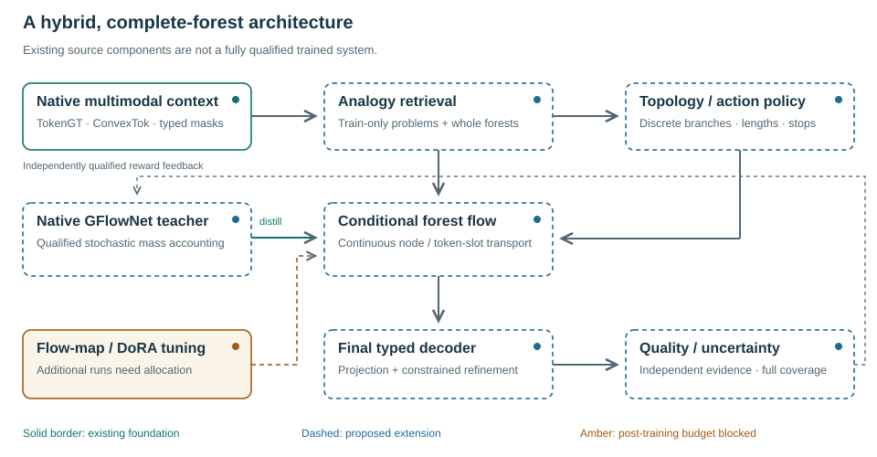
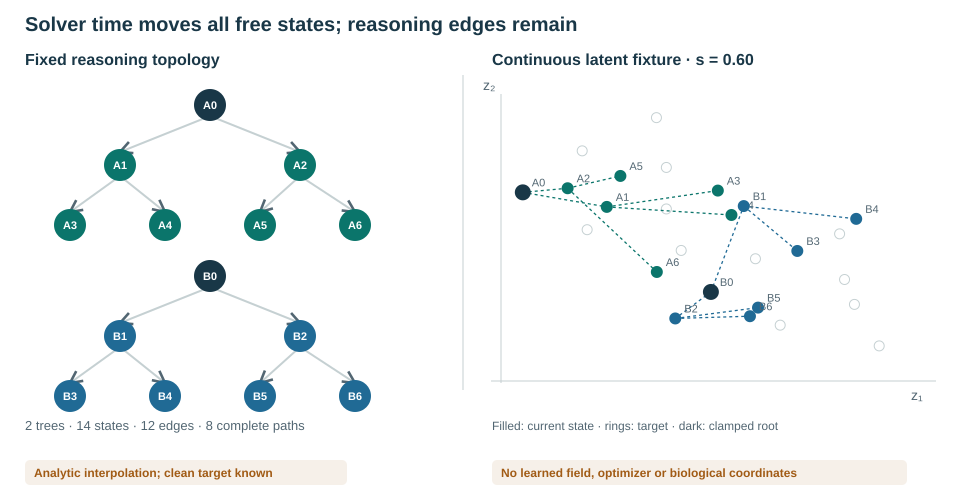
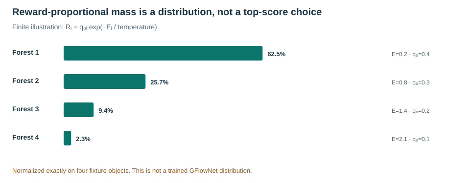
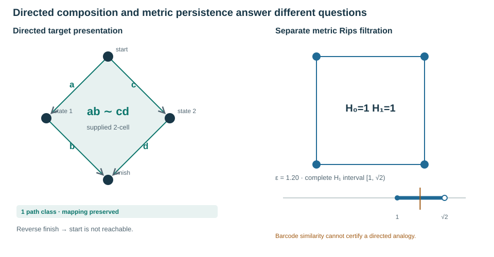
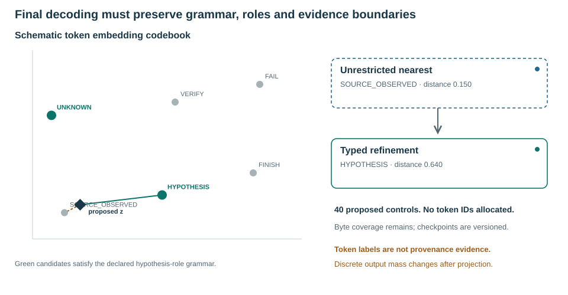
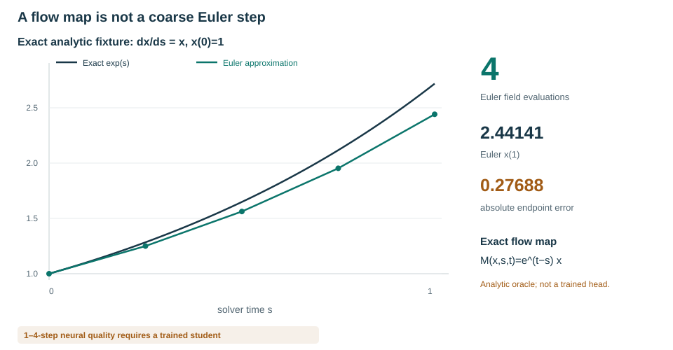
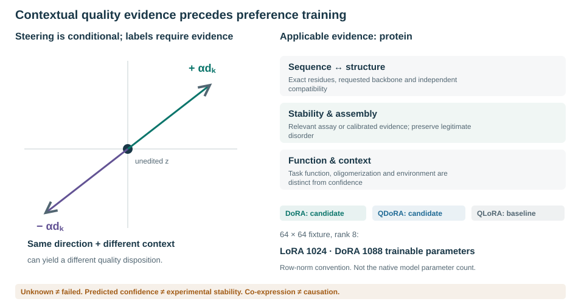
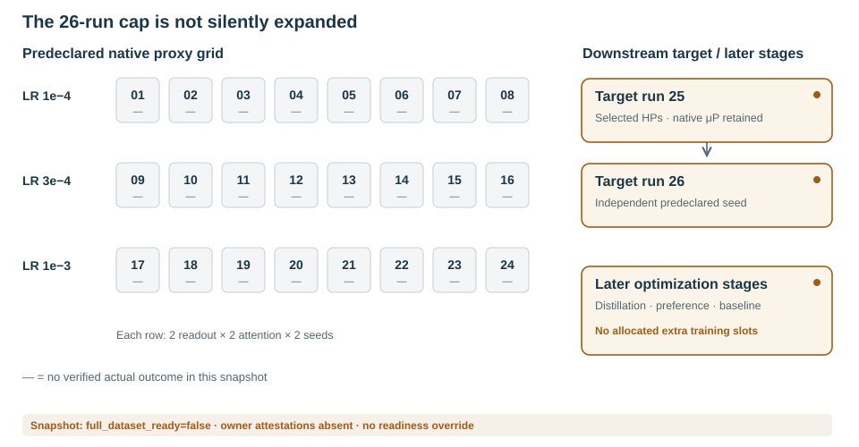
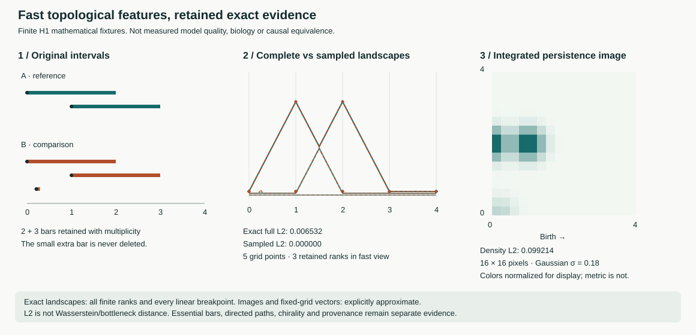

# Proposed extension: flow-generated complete reasoning forests

**Private methods supplement, FRF-00,11 November2026.** The neural methods in this supplement are proposed and untrained. The interactive companion and its exact mathematical illustrations are implemented; they are not empirical results. The original manuscript's historical44-run comparison is superseded by the current24-proxy plus two-target cap. Additional distillation or preference-training runs have no allocation under that cap.

## Hybrid representation and native integration

We propose representing the generated object as a complete forest F=(T,Z,A), with discrete topology/actions T,A and continuous node or token-slot embeddings Z. A separately normalized topology policy is necessary for unknown structure. Initial implementation conditions the continuous flow on a declared skeleton. Shared prefixes are represented once, censored leaves remain explicit, and source/desired/generated/target roles are not interchangeable. The native TokenGT, ConvexTok and selected ordinary/tropical operator are preserved rather than replaced by a second unrelated language model.

**Figure1.** Solid border denotes an existing foundation, dashed border a proposed extension, and amber an unallocated post-training stage. The diagram is a design specification. Existing component tests are not full native-model release evidence.

A conditional flow transports all free forest coordinates using a declared base-noise path, while clamping known context. Solver time s is distinct from reasoning depth d. In a straight-path reference, Z_s=(1−s)ε+sZ_1 and the target velocity is Z_1−ε; only legitimate available coordinates contribute to the loss. Native width-scaled versus finite axes, readouts, aliases, checkpoint/RNG state and the actual full-head parameter count must be qualified before the applicable μP sweep. No current all-head count is inferred from the diagram.

**Figure2.** Two fixed trees have14 states,12 edges and eight complete root-to-leaf paths. Two known roots are clamped. The right-hand points are exact analytic interpolation in a schematic two-dimensional space, not a learned field, molecular coordinates or measured generation quality. Moving s changes all free coordinates without shortening the reasoning graph.

## Probability, feedback and analogy

The target forest measure is π*(F|c)∝R(F,c). A hybrid counting/continuous reference measure and a construction/backward policy must specify whether terminal objects are ordered histories or forest equivalence classes. Their multiplicities differ. An integrable design R=q0 exp(−E), E≥0, separates a normalized base from a domain-conditioned energy. A scalar maximum-reward objective is not identical to this sampling target.

The initial integration will distill a separately qualified stochastic GFlowNet distribution into a conditional flow. Its teacher must be evaluated, not presumed exact. Deterministic ODE updates do not carry Gaussian transition log probabilities. SDE-based flow RL and negative-aware fine-tuning are separate, explicitly named alternatives. Beam-pruned FoT is not on-policy evidence for an unchanged GFN kernel.

**Figure3.** Four fixture forests use base masses(0.4,0.3,0.2,0.1) and energies(0.2,0.8,1.4,2.1); probabilities are normalized from q0 exp(−E). These values are computed examples, not learned frequencies or reward calibration.

Analogy retrieval uses only available query conditions and train-only group-disjoint problem/forest exemplars. A learned approximate shortlist is followed by full directed relational checks, intermediate subgoal mapping, branch coverage and abstention. Source actions may map to target subtrajectories. Approximate retrieval recall is compared with an exact reference. Frozen encoder/codebook identity is necessary because latent gauge changes invalidate stored geometry.

**Figure4.** A supplied two-cell identifies the paths ab and cd; deleting it makes the proposed defining-relation map fail despite unchanged endpoints. Reverse reachability is not inferred. The independent metric example is F₂ Rips homology of a unit square: H₁ is born at1 and dies at√2. Equal barcodes do not prove semantic, geometric or causal equivalence. This finite interpretation is informed by Grandis's directed path and positive-chain constructions; it is not a reconstruction of a continuous biological fundamental category.

## Final token refinement

The existing pooled payload representation is lossy. A new aligned token-slot decoder must be learned before nearest-codebook projection can be useful. Proposed40 reserved control symbols represent structure, actions, evidence roles, relations and dispositions; they are not a recovered Jev vocabulary and have no allocated IDs yet. TypeSafe's public Jev interface motivates typed outputs, not a claim that finite token choices prevent factual errors.

**Figure5.** An unrestricted nearest vector may represent an inadmissible evidence label. A declared grammar restricts refinement to allowed types. The plotted codebook is schematic. A generated SOURCE_OBSERVED symbol is not source evidence. Projection is many-to-one, so discrete output probabilities integrate latent mass over decoding regions and need not preserve latent reward proportionality.

## Few-step conversion and contextual quality adaptation

We select DMF-informed flow-map conversion for native qualification, beginning with frozen-teacher interval-pair regression rather than presuming JVP support in first-order tropical kernels. Learned M(x,s,t) should retain identity and approximate composition. MeanFlow and Align Your Flow are method references; newer MFD is a screened alternative. Image-domain benchmarks do not establish performance for Mora-3 forests.

**Figure6.** Exact x(s)=exp(s) and Euler approximations illustrate discretization error. The analytic one-step map is an oracle, not a trained student. Neural1/2/4-step quality, diversity and end-to-end latency require real validation, counting topology, guidance, retrieval and decoding work as well as solver evaluations.

Quality adaptation begins with matched-context signed GraphCG exploration and an unedited control. A direction is not globally bad. Preference records distinguish favored/disfavored, neutral, unknown, conflicting and hard-infeasible cases. Independent outcome evidence and applicable uncertainty determine labels; missing assays are not negative examples. Protein confidence/refolding agreement alone is not experimental stability or function. Mixed-cell communication requires context-specific evidence, not co-expression relabeled causality.

**Figure7.** The evaluation contract is modality-dependent. BF16 DoRA is the quality-first engineering candidate, QDoRA the quantized candidate and QLoRA the reference baseline; there is no established native-model winner. The displayed64×64,rank8 parameter counts are exact algebraic illustrations, not the Mora-3 parameter count. Tied aliases, finite axes, sensitive reductions, norm conventions and tropical behavior require native tests. No packages or adapters were installed.

## Experiment accounting and current evidence

**Figure8.** The authorized base campaign remains24 proxies and two targets. Dashes indicate no verified actual outcomes in the inspected campaign evidence. Later flow-map distillation and preference/baseline training are budget-blocked. They are not relabeled continued runs to evade the cap.

FRF-00 implements the specification and reference visualizations, not the neural extension. At the inspected source snapshot, full_dataset_ready=false, construction/model attestations are absent and the native owner refuses training admission. Current source-exposure/group audits are preserved. No training result, therapeutic efficacy, causal validity or model-quality improvement is asserted.

Full equations, native integration acceptance criteria, failure modes, modality-specific quality requirements, the40-control registry and the ordered task graph are in `../planning/flow_forest_extension_20261111.md`. Exact research/code review boundaries are in `../docs/research/flow_forest_sources_20261111.json`. The interactive companion is `../docs/project/flow-forest.html`; these static vector figures are intended for manuscript inclusion. The paper/PDF itself is not claimed to contain interactive controls.

### Primary references

Flow Matching, arXiv:2210.02747v2; Continuous GFlowNets,2301.12594v2; MeanFlow,2505.13447; Decoupled MeanFlow,2510.24474; Align Your Flow,official NVIDIA research page; Flow-GRPO,2505.05470v3; DiffusionNFT,2509.16117; DoRA,2402.09353v6; QLoRA,2305.14314; PEFT0.21.0 commit9dc6fa2d2093853dec3889b790d4f251efe7fcac; Grandis,Directed Algebraic Topology(2009); Topological Autoencoders,ICML2020; ProteinBench,2409.06744; Limitations of the refolding pipeline for de novo protein design,Protein Science(2026),doi:10.1002/pro.70613. The detailed planning bibliography provides direct primary-source links and distinguishes screened from implementation-reviewed work.

## Vectorized persistence and information-preserving evidence retention

The implementation now provides batched persistence landscapes, Gaussian pixel-integrated persistence images and explicit L2 feature metrics. Complete finite landscapes are invertible in the mathematical setting; fixed-grid samples, rank truncation and finite images are generally not. Original native diagrams, multiplicities, pairing simplices and essential/censored metadata are retained. Directed path categories and causal/evidence labels remain independent, as do signed geometric constraints such as chirality.

For complete finite diagrams, all births, deaths, peaks and active ascending/descending tent crossings define a shared piecewise-linear basis. Two-point Gauss quadrature on each interval yields Euclidean feature vectors whose squared distance equals the full landscape L2 integral in real arithmetic, with all layers retained. Float64 rounding and explicit resource bounds remain. Sampled features instead use square-root trapezoidal weights and are labeled approximate. Gaussian image pixels integrate density over rectangles; pixel-mass L2 and image-density L2 (mass divided by the square root of pixel area) are explicitly different metrics. Neither is silently identified with bottleneck or Wasserstein distance.

Native condition-only topology-memory retrieval now defaults to batched exact finite-landscape L2, scores every eligible disjoint-group training memory and requires matching essential birth multisets. The original directed/bottleneck structural verifier is unchanged; no acceptance threshold was reinterpreted. Censored filtrations refuse rather than being capped or treated as complete. These numerical components do not grant source/model admission or imply trained reasoning gains.

**Figure9.** Two reference intervals are compared to two shifted intervals plus an optional short interval [0.21,0.29]. At zero shift and a five-point grid on [0,4], coarse sampling misses the extra interval while exact full-landscape L2 detects it. The image panel is a Gaussian-integrated feature summary, not a lossless barcode. Display color normalization does not alter the numerical distance. These are mathematical fixtures, not biomedical observations or trained-model evaluations. The [interactive companion](../docs/project/persistence-vectors.html) and paper SVG share one renderer.

Primary sources: Bubenik (2015), JMLR16(3), https://jmlr.org/papers/v16/bubenik15a.html; Bubenik, https://arxiv.org/abs/1810.04963; Adams et al. (2017), JMLR18(8), https://jmlr.org/papers/v18/16-337.html. See [implementation/qualification contract](../planning/persistence_vectorization_20261111.md).
