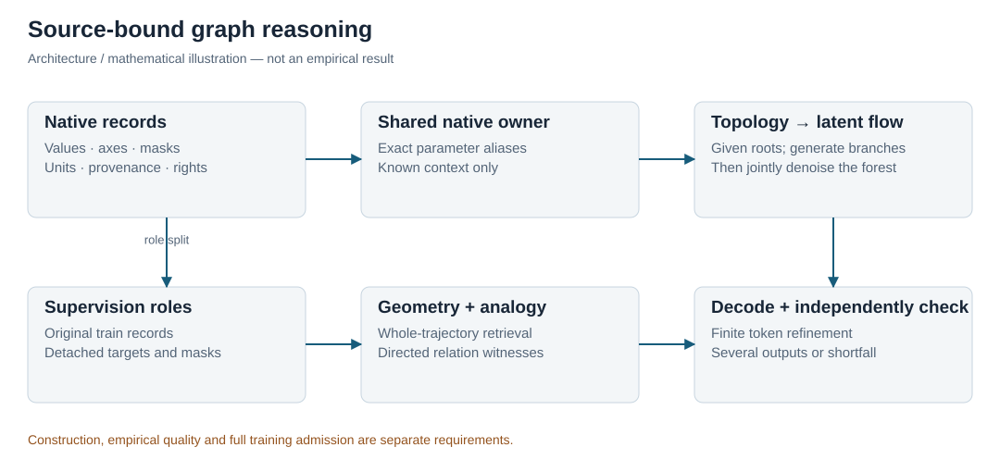
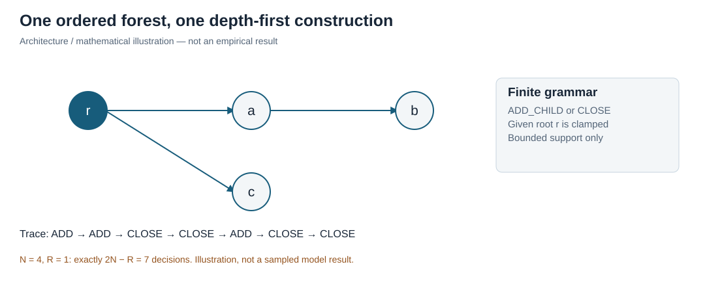
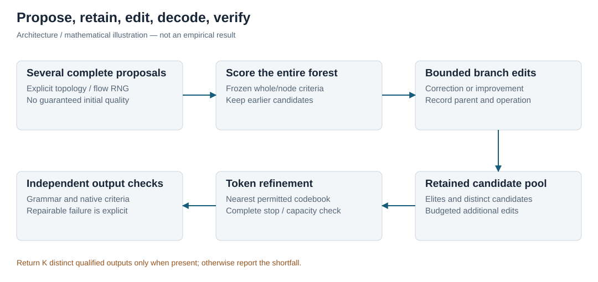
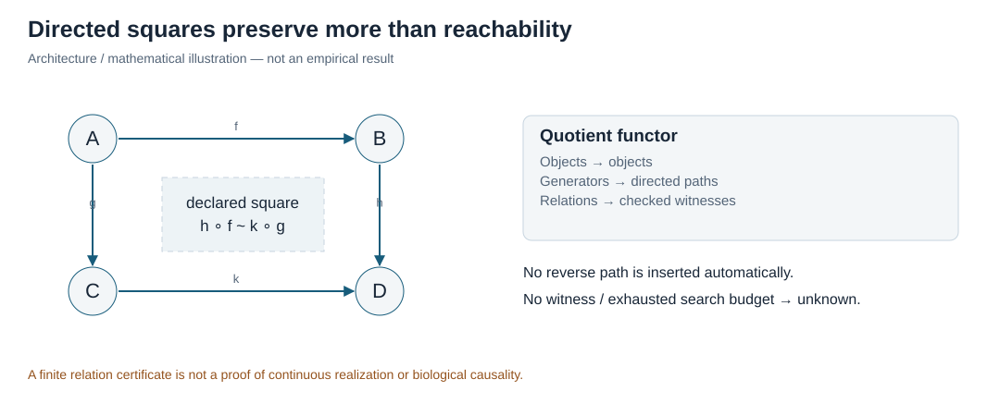
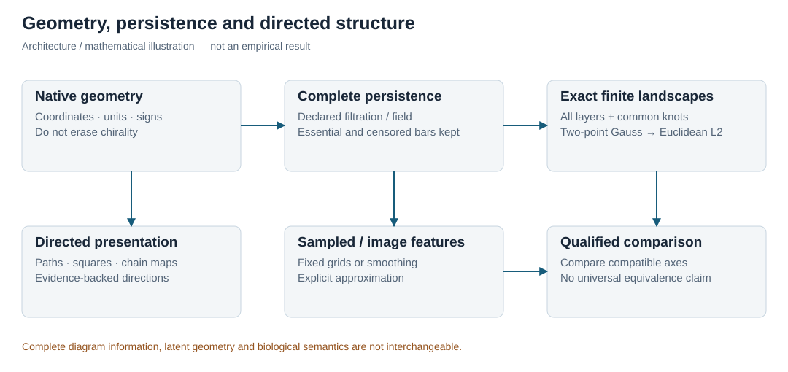
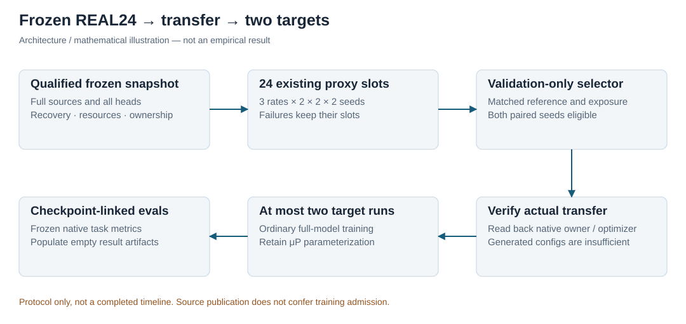

# Mora-3: Source-Bound Multimodal Graph Reasoning with Directed Topology and Generative Forests

**Working methods and theory manuscript — 14 November 2026.**

**Empirical status.** This manuscript specifies the construction, implemented mechanisms, mathematical assumptions, training protocol and evaluation design. Its empirical tables and charts are intentionally unpopulated. They must not be interpreted as zero scores, failed experiments, completed sweeps or trained-model measurements. Architecture diagrams and mathematical illustrations are complete; interactive versions accompany the live manuscript. Implementation tests establish scoped software properties, not biological efficacy or empirical hyperparameter transfer. The full expanded source/model campaign remains subject to the release requirements in Section 11.

## Abstract

Mora-3 investigates a shared graph-native computational substrate for molecular, protein, cellular, tissue, image, sequence and bioelectric data. Its construction retains native measurement axes, units, availability and provenance instead of inventing cross-modal joins. We formulate reasoning outputs as complete directed trajectory forests, separate available problem context from source supervision, and factor variable-size forest generation into a normalized discrete topology policy and a conditional continuous flow. A shared native transformer supports flow velocity, token refinement, quality estimation and analogical retrieval. Directed path presentations and explicit chain maps complement geometric distances and persistent-homology features: neither undirected topology nor pairwise semantic similarity alone constitutes a trajectory analogy. We give finite-support normalization, prefix noninterference, conditional-flow, reward-pushforward, directed-functor and exact landscape-distance propositions with explicit assumptions. A bounded forest-editing controller retains candidate lineage and can return several independently checked outputs or a transparent shortfall. A fixed 24-trial maximal-update-parameterization campaign and at most two approximately 80-million-parameter target runs define the authorized empirical program. The paper supplies complete result schemas but reports no trained-model scores. Important remaining qualification boundaries include full eligible data coverage, source-grounded trajectory labels, the hybrid reward teacher, end-to-end resource/recovery evidence and a reviewed release for the complete enabled owner.

## 1. Problem and contribution boundaries

The project studies conditional graph-to-graph prediction and generation across modalities whose physical meaning is not reducible to one undifferentiated text stream. A protein sequence, a coordinate frame, a gene-count vector, a microscopy channel and a membrane-voltage trace have different native axes and different admissible transformations. The model may share computation without declaring those observations interchangeable. In particular, a computed conformer is not an experimental observation, a simulated membrane trace is not an intervention study, and a generated explanation is not evidence that its biological mechanism occurred.

The research objective is to learn a distribution over complete candidate solutions together with structured reasoning trajectories. A trajectory includes intermediate states, typed operations, branching, references and terminal dispositions. We do not define analogy as an isolated equation between two concept vectors. Instead, an analogy candidate maps a source problem and its whole supported solution process to a target problem while preserving specified relational and geometric constraints. Approximate embedding retrieval proposes candidates; explicit checking determines which stated relations survive the mapping.

Three distinctions organize the construction. First, a lossless source codec and a lossy learned embedding are separate objects. Second, a normalized sampling distribution, a high verifier score and real scientific quality are separate properties. Third, a mathematically valid operator, a tested implementation and a qualified full training campaign are separate levels of evidence. Throughout this paper, **implemented** refers to inspectable source paths, **proved** to a stated mathematical implication under assumptions, and **unmeasured** to an empirical quantity awaiting an actual qualified run.

The central implementation modules are `model/full_owner.py`, `model/forest_flow.py`, `model/forest_topology.py`, `model/forest_token_decoder.py`, `model/forest_quality.py`, `model/forest_analogy.py`, `model/forest_training.py`, `research/forest_training_routes.py` and the corresponding reasoning/data modules. All paths are relative to `src/mora3`. This manuscript does not infer completeness from a module's presence. The assembly, source identities, native operators, parameter aliases, optimizer and recovery protocol must agree in one released snapshot.



## 2. Relation to primary research

TokenGT studies pure transformers supplied with graph structural identifiers [R1]. Mora-3 uses native node/edge incidence and exact shared transformer objects, but that connection alone does not prove universality for this complete finite-width implementation. Expressivity statements for an idealized transformer or graph encoding are not sample-complexity bounds, optimization guarantees, reliable biochemical reasoning, or proofs that every implemented head transfers its hyperparameters.

ConvexTok formulates vocabulary construction through an integer program and a convex relaxation, with rounding and a compression lower bound [R2]. The relevant distinction is between solving a frozen byte-token segmentation problem and proving a global tokenizer optimum. Mora-3 retains its exact native payload codec and vocabulary commitments. A shortest-path encoder or finite control-token extension does not by itself reproduce every ConvexTok optimization or optimality certificate. Vocabulary construction must use eligible training data only; any fitted compression objective, candidate vocabulary and certificate belong in the frozen source manifest.

The four requested analogy studies motivate different parts of the design. Korchinski et al. derive linear analogies under a structured co-occurrence model with binary attributes and a factorized spectral construction [R3]. That result motivates inspecting relational coordinates; its assumptions do not establish a theorem for arbitrary biological trajectories. Minegishi et al. study synthetic cross-category correspondence and identify geometric alignment and functor application mechanisms, with sensitivity to data, scale and optimization [R4]. Their controlled correspondences motivate explicit relation-preservation tests rather than a universal analogy claim.

Shen et al. use object mappings and shared relations to search across scientific domains [R5]. This motivates distinguishing structural coverage, novelty and applicability: a more novel proposal need not be a more reasonable or experimentally supported solution. Yasunaga et al. study self-generated reasoning exemplars in analogical prompting [R6]. Mora-3's learned, source-bound retrieval over complete forests is an adaptation, not an assertion that prompting results automatically transfer to its much smaller native model.

Conditional flow matching supplies a regression formulation for continuous vector fields [R7]. GFlowNet trajectory balance targets a reward-proportional terminal law under its own stochastic-policy assumptions [R8]. These are related distribution-learning tools, but a deterministic Euler flow step is not a stochastic GFlowNet transition with an arbitrary Gaussian likelihood. Forest-of-Thought introduces multi-tree reasoning, sparse activation, dynamic self-correction and consensus-guided decisions [R9]. Mora-3 adapts these ideas to retained latent forests and independent decoded-output checks, while keeping edited or selected proposals separate from on-policy samples.

Grandis develops directed spaces, distinguished paths, directed homotopies and fundamental categories for non-reversible phenomena [R10]. We use this terminology carefully. The implemented finite path presentation is a combinatorial, evidence-labelled object; it is not automatically the fundamental category of a physical biological state space. Persistence landscapes [R11,R12] and persistence images [R13] offer different vector representations. Complete finite landscapes and fixed sampled images do not have interchangeable information guarantees. GraphCG supplies a learned-steering motivation [R14]; the meaning and safety of a steering direction still require modality-specific evaluation. Maximal-update parameterization motivates proxy-to-target hyperparameter transfer [R15], while MeanFlow and related few-step techniques motivate, but do not establish, a future low-step refinement stage [R16]. QLoRA and DoRA define relevant adaptation references [R17,R18], not an already demonstrated best adapter for Mora-3.

## 3. Native records, source identity and information boundaries

### 3.1 Typed multimodal records

A native record is a finite graph with typed nodes and edges, measurement payloads, explicit axes, units, availability and provenance. Every supervised field has a task role. A **condition** is observed and available to the predictor. A **desired** field is a user-declared constraint rather than an observed outcome. A **target** is withheld from predictor inputs and may supply an available training label. Evaluation-only metadata must not become a condition through serialization, identifiers, retrieval, topology construction or a reward guide. Missingness is represented by an explicit mask and reason; it is not silently replaced with an observed zero.

For a source record x and a task contract c, let I(x,c) denote the exact permitted predictor inputs. It contains only the selected fields and genuinely known graph structure. A source identity may be required to verify an artifact without being encoded as a model feature. Conditioning hashes commit to the actual input view, whereas source hashes commit to original records and supervision. These two hashes need not agree and serve different purposes.

Molecular records retain atomic identity, bond type, charge, stereochemical information and the applicable coordinate/energy conventions. Protein records retain sequence/residue numbering, chain and assembly identity, coordinates and masks. Cellular records retain the native gene axis, count or assay representation, donor/study grouping, cell-type and perturbation context where supplied, and the stated control/combination protocol. Images retain channel order, spatial coordinate conventions and source masks. Bioelectric and tasmorpho/BETSE records retain time, cell/mesh identity, physical units, simulation parameters and the distinction between aggregate exports and per-cell trajectories. None of these contracts licenses fabricated measurements, unrecorded temporal ordering or cross-study intervention claims.

### 3.2 Source-bound assembly and shared ownership

`SourceBoundOwner` registers the actual native branches and their shared modules. Its invariant is object identity, not merely equal parameter values. A flow head, analogy head, decoder, quality head and optional topology head reuse the same designated forest field and native geometry/transformer. Parameter inventories count each unique tensor once and retain all alias names. The width-family audit must cover every enabled parameter, finite axis and shared alias; omitting an optional head changes the model being qualified.

The ordinary-attention primary family and tropical-attention research path are not conflated. In the native forest path, the applied maximal-update policy currently qualifies ordinary attention. A tested tropical operator is not a proof that the same width scaling or optimizer multipliers remain valid for a max-plus attention architecture. Such an extension requires its own operator and width-family qualification before a release can select it.

### 3.3 Complete source-prefix export

The source compiler preserves all supported vertices and branches of an original reasoning tree. It constructs each root-to-node prefix and encodes that prefix with a separately frozen native encoder. Original lexical payload bytes, record ordinals, groups, source revision, role and evidence category remain bound. A frozen clone prevents a training update to the live owner from silently changing previously exported latent coordinates. The decoder codebook is exported from the actual extended native token-embedding rows, not replaced by an unrelated random matrix or a relabelled metadata axis.

The source-known-tree exporter refuses merged histories, nontrivial unsupported relation squares, censored branches and capacity overflow rather than flattening or truncating them. General DAGs remain representable in the separate directed presentation and native graph interfaces; their conversion to one tree-training representation needs an explicit semantics-preserving policy. Exact byte readback does not imply invertibility of the learned encoder. A production encoder export additionally needs its qualified source checkpoint and provenance; the retained untrained numerical reference exports remain evaluation-only.

### Proposition 1. Prefix noninterference

Fix the input-selection contract, known prefix topology, encoder parameters, codebook, runtime arithmetic and any supplied random state. Let x and x' be records whose selected prefix input views are identical. If all predictor operations are functions of that view and the fixed objects only, the resulting prefix embeddings and next-topology-action logits are identical in exact arithmetic. Under deterministic identical floating-point kernels they are identical operationally as well.

**Proof.** The selected serialized payload and known graph incidence are equal by hypothesis. Their token sequences, positional/structural identifiers and masks are consequently equal. Induct on the sequence of deterministic tensor operations: equal inputs and fixed equal parameters give equal outputs at each operation. The final embedding and readout are therefore equal. With randomness, couple the executions using the same random state and apply the same argument to each randomized operation's explicit inputs. No variable outside the permitted view occurs in this induction. The proposition does not apply when a future value changes supposedly known topology, a fitted preprocessing statistic, a retrieval memory or a hidden random source. It establishes an information-flow property, not biological causality.

## 4. A normalized policy over generated forest topologies

### 4.1 Finite support and canonical state

The condition contract supplies an ordered list of R root states. The model generates descendants and branches; it is not given the complete target tree. The support is an ordered rooted forest with at most M vertices, maximum depth D and at most C children per vertex. Roots retain their declared order. Source sibling order is retained during canonicalization; this is a distribution on ordered representations, not on unlabelled graph isomorphism classes.

A construction state contains the parents created so far, their depths and child counts, the closed vertices, a depth-first stack and the number of completed roots. Two actions suffice. **ADD_CHILD** appends a child of the current stack top and pushes it. **CLOSE** closes and pops that vertex; after a root closes, construction moves to the next given root. ADD_CHILD is unavailable at a node, depth or child-capacity boundary. CLOSE remains available at every nonterminal prefix. Roots are never generated from withheld target information.

The native policy reuses the actual field's context encoder and graph transformer. Its own finite-to-hidden projection receives depth, child count, closure, stack membership, current-vertex indicator, root indicator and completed-root count. Prefix node and directed-edge tokens are constructed only for vertices already present. A two-action readout produces logits; masking followed by log-softmax normalizes over the currently valid actions. The separate context input uses the same condition/desired-field filter as the field.

```math
\pi_\theta(a\mid c,s)=\frac{\exp \ell_\theta(c,s,a)}{\sum_{b\in A(s)}\exp \ell_\theta(c,s,b)},\qquad a\in A(s).
```

Invalid actions have probability zero. The implementation uses stable log-softmax, but real-arithmetic positivity and exact normalization are mathematical statements; finite-precision underflow and sampling arithmetic require numerical qualification. Sampling uses an explicit generator, evaluation mode and a bound policy snapshot. A failure before optimization restores that generator. Such recovery does not claim rollback of an optimizer that has already changed parameters.

### Theorem 2. Finite termination, unique construction and normalization

For fixed R, M, D and C with 1 ≤ R ≤ M and the grammar above: (i) every valid action sequence terminates after at most 2M−R actions; (ii) each admissible ordered forest has exactly one complete depth-first construction trace; and (iii) any normalized action kernel on valid actions induces a normalized probability distribution over the admissible ordered forests.

**Proof.** Initially R vertices exist. Each ADD_CHILD creates exactly one new vertex, so there can be at most M−R such actions. Each CLOSE removes one distinct currently open vertex; a closed vertex is never reopened. At most M CLOSE actions occur. A nonterminal state always permits CLOSE, and no other action creates a cycle or reopens completed work. Thus every valid path ends, with N−R additions and N closures for its final N vertices, giving exactly 2N−R actions.

For uniqueness, recursively visit the given roots in order and, within each vertex, its ordered children. A child's entire subtree must be constructed and closed before its next sibling can be added. Therefore the first action at any prefix is forced by whether the next ordered child exists; after the final child, CLOSE is forced by the representation. This constructs one trace for each forest. Conversely replaying any trace yields exactly that ordered forest. The mappings are inverses.

For normalization, expand the finite tree of all valid action prefixes. Assign mass one at its root and send a prefix's mass to its children according to the normalized kernel. The outgoing masses sum to the incoming mass at every nonterminal prefix. Repeated conservation over this finite construction tree leaves total mass one on its terminal traces. The established bijection transfers that mass to forests. The theorem does not guarantee high-quality forests, semantic diversity, learned optimality or a normalized law over an alternative quotient of the ordered representations.

```math
p_\theta(T\mid c)=\prod_{j=0}^{2|T|-R-1}\pi_\theta(a_j\mid c,s_j),\qquad \sum_{T\in\mathcal T_{M,D,C,R}}p_\theta(T\mid c)=1.
```

The native runtime must be able to evaluate the complete declared support, not merely its initial prefix. For R roots, maximum depth D, child bound C and node cap M, the exact attainable maximum is the smaller of M and R times the finite sum of C to the powers zero through D. This follows from the depth-wise branching bound; a full bounded tree attains that sum, and repeatedly removing leaves attains any smaller node count down to R. For C=0 or D=0 the maximum is just R. The runtime checks the resulting native node/edge attention bound before any neural evaluation or sampling. It refuses an incompatible support rather than silently rejecting later draws and thereby changing the normalized law. The versioned resource policy is part of the topology checkpoint configuration; this abstract tensor-element bound does not replace measured whole-model memory qualification.

### 4.2 Supervision and native integration

Source supervision is a complete original parent array plus a declared root-count and construction policy. Canonicalization returns a bijection between canonical and original vertex indices, preserving payload alignment. Teacher forcing derives next labels from the source forest but passes only the already available construction prefix to the neural policy. The loss is mean complete-trace negative log probability across source forests, not a mean over individual decisions that inadvertently changes the weighting of long and short forests.

```math
\mathcal L_{\mathrm{top}}=-\frac{1}{B}\sum_{b=1}^{B}\log p_\theta(T_b\mid c_b).
```

The optional topology head is registered in the source factory, unique-parameter inventory, full-owner checkpoint validation and maximal-update role declarations. With hidden width w, its seven-input projection and two-action readout add 10w+2 unique parameters; shared backbone tensors are not counted again. This algebraic count describes this head only, not a final complete-model count. Disabled topology preserves the prior serialized owner configuration and objective identities. The source route uses an explicit new binding version when topology supervision is enabled and retains the old binding when it is absent.

The topology objective can be combined with the existing flow, token, quality and analogy objectives. Its labels retain source role, original identities and evidence commitments. Original validation/test records cannot become training labels through this adapter. The complete native engine still checks genuine full-owner admission before route access; a normalized grammar is not a new authorization path.



## 5. Continuous forest flow and hybrid probability

### 5.1 Joint latent denoising conditional on topology

For a known or sampled topology T, each non-root vertex has a latent vector in a fixed source-bound coordinate system. Root coordinates are given conditions and remain clamped. A forest field takes the full noisy forest, continuous solver time, structural features and available problem context. It uses all noisy branches jointly. This joint denoising is not a clean-prefix autoregressive policy: looking at another noisy branch during this conditional generation task is legitimate, whereas inserting another branch's clean target into the topology or source-prefix policy is not.

For fully observed free coordinates, the implemented conditional Gaussian path is:

```math
X_t=tY+[1-(1-\sigma)t]\varepsilon,\qquad U_t=Y-(1-\sigma)\varepsilon,\qquad \varepsilon\sim\mathcal N(0,I),\quad t\sim\mathcal U[0,1].
```

The source target Y is detached. The availability mask is applied before arithmetic. Unavailable coordinates receive independent noise and no supervised flow loss; unavailable or NaN labels must not contaminate a calculation through multiplication after they have already entered an expression. Clamped roots receive zero velocity. The default positive terminal scale means X at time one is Y plus residual noise, not exactly Y. The method follows conditional flow matching [R7]; the particular complete-forest context sharing is a project adaptation.

### Proposition 3. Conditional regression optimum and its limit

Assume the fully observed path has finite second moments, the necessary conditional expectations exist, and conditioning includes the fixed topology and allowed context. Among square-integrable vector fields, the minimizer of expected squared velocity error is the conditional expectation of U given X, time and conditioning, up to null sets. If the probability path and vector field satisfy the regularity conditions for the continuity equation and a well-posed flow, the resulting marginal field transports the path's marginals. A loss observed on only a subset of coordinates does not, without additional assumptions, identify the complete joint target law.

**Proof.** Write m(X,t,c,T) for that conditional expectation. Expand the squared error as the squared norm of v−m plus the squared norm of m−U plus twice their inner product. Conditioning on X,t,c,T makes the expected cross term zero because the conditional mean of m−U is zero. Therefore the risk equals an irreducible term plus the expected squared distance from v to m, minimized at m. For a smooth compactly supported test function f, differentiating its expectation along the conditional path gives the expectation of its gradient dotted with U. Conditioning yields the same expression with m. This is the weak continuity equation for the marginal path; uniqueness under the stated regularity identifies its transport. If some coordinates are never supervised, distinct joint laws can agree on every observed loss term while differing in their unobserved dependence. The last claim follows from this non-identifiability. Numerical Euler error, finite capacity and optimization error remain outside the transport conclusion.

### Proposition 4. The discrete–continuous forest law

Let p(T|c) be the normalized finite topology law and let q(z|T,c) be a normalized density on the free coordinates of each topology. Then their product defines a normalized law on the disjoint union of topology-specific latent spaces, with counting measure over topologies and the corresponding Lebesgue measure within each space.

```math
\sum_T\int_{\mathbb R^{d_T}}p(T\mid c)q(z\mid T,c)\,dz=\sum_T p(T\mid c)=1.
```

**Proof.** Integrate each conditional density first; its integral is one. Sum the remaining topology masses. The dimensions may differ because the spaces form a disjoint union, rather than one incorrectly padded Lebesgue space. Fixed condition roots contribute point masses and are not integrated as generated dimensions. This establishes a well-defined target factorization; it does not assert that the current finite neural field realizes an arbitrary conditional density or that a partially supervised trained model is calibrated.

In source training, conditioning the continuous factor on a source topology is ordinary teacher conditioning for q(z|T,c); it does not justify passing that topology into the predictor of p(T|c). At inference, the separately generated topology replaces the source topology. The sampler records both stages and their identities. The existing complete-forest refinement controller may assess and edit these proposals, but selection/editing changes their law and must not inherit the topology sampler's on-policy label.

## 6. Reward-guided trajectory learning and forest editing

### 6.1 Complete trajectories, not endpoint surrogates

The terminal object of the trajectory reward is the entire ordered process, including its intermediate states and supplied relation structure. An endpoint-only energy cannot distinguish two processes with identical endpoints but incompatible intermediate behavior. The existing fixed-horizon continuous trajectory route uses a positive base density over increments and nonnegative complete-trajectory energies. Guides are train-only, group-disjoint and bound to an encoder/frame or an independently verified alignment. Computed or model-generated guide evidence is not relabelled as an observed biological outcome.

A mathematically convenient reward density is a normalized base density multiplied by an exponential penalty:

```math
R(\tau\mid c)=q_0(\tau\mid c)\exp[-E(\tau,c)],\qquad E\geq0,\qquad 0<Z(c)=\int R(\tau\mid c)d\tau\leq1.
```

The upper bound follows pointwise from exp(−E)≤1. Strict positivity additionally requires finite energy on a set with positive base probability. A reward that is zero almost everywhere does not define a useful terminal distribution. Coordinate frames, scale, topology tie policy, guide groups, energy weights and method family must be frozen before sampling or selection.

### Theorem 5. Exact trajectory balance implies the terminal reward law

Consider a finite acyclic construction graph with one source, terminal set X, a normalized forward policy and a normalized backward policy from each terminal to the source. Assume every relevant terminal is reachable, every backward construction terminates at the source, rewards are positive and finite, and trajectory balance holds for every complete path. Then the forward terminal probability is R(x)/Z, and Z is the sum of terminal rewards. This is the finite trajectory-balance principle [R8], stated here to expose the required path accounting.

```math
Z\prod_{e\in\tau}P_F(e)=R(x)\prod_{e\in\tau}P_B(e^{\mathrm{rev}}).
```

**Proof.** Fix terminal x and sum the equality over all complete source-to-x paths. The left side becomes Z times the forward probability of reaching x, including all construction paths. The sum of backward path probabilities on the right is one by normalized backward transitions and finite termination at the unique source. Hence Zp(x)=R(x). Summing over x and using normalized forward termination gives Z equal to the sum of rewards. A unique-prefix construction tree has deterministic backward deletion and removes the backward multiplicity term. The argument does not hold merely because a finite batch has low residual, or if selected/edited histories are assigned an unchanged forward sampling probability.

The current normalized topology NLL is not itself a trained GFlowNet reward objective. The fixed-horizon native path-space GFlowNet and the topology/conditional-flow factorization are implemented components with different state and density conventions. Their complete variable-topology stochastic teacher, conditional normalizer, mixed-measure reward and flow-student training protocol still need a single qualified source/owner integration. Deterministic ODE maps are not assigned invented stochastic transition densities to close this gap.

### 6.2 Candidate generation, editing and multiple outputs

The inference controller begins with several full-forest latent proposals. A frozen evaluator scores both whole forests and their supported nodes. A bounded active set prioritizes strong or repairable candidates; edits can correct branches, replace subtrees, extend an admissible computation or revise an unsuitable candidate while preserving fixed conditions and complete edit lineage. The controller retains earlier candidates rather than overwriting their evidence. Duplicates still consume their recorded proposal budget; they do not create fictitious diversity.

Only complete latent forests reach the decoder. A separate decoded-output evaluator checks structure, grammar and domain criteria after token refinement. Repairable decoded failures can request additional edits within an explicit post-decode budget. The output set requires both sufficiently strong decisions and declared distinctness. If fewer than K candidates satisfy the frozen conditions, the result is a shortfall, not a padded list of unchecked answers. A learned score is a prediction; independent evaluation and source coverage determine what that score can support.

### Proposition 6. Retained elite score cannot decrease under a fixed evaluator

Let candidate sets be nested by retention, and evaluate every candidate with the same deterministic scalar scoring function. Then the maximum score over the retained set is nondecreasing with each addition. It need not strictly increase, and no analogous guarantee follows for unknown true scientific quality.

**Proof.** The previous maximizing candidate remains in the next set. The next maximum is therefore at least its unchanged score. A stochastic or drifting evaluator, removal of earlier candidates, or replacement by an unverified edit breaks the assumptions. Diversity thresholds can also make a chosen K-output subset's aggregate score differ from the unqualified retained maximum. This proposition concerns bookkeeping under a fixed criterion, not clinical or mechanistic improvement.



## 7. Finite token refinement and multimodal quality

### 7.1 Source-bound token axis and decoder

The finite extension appends 40 typed forest, direction, evidence, analogy and output-control tokens to the committed native vocabulary. It does not reinterpret old metadata rows as newly learned controls. Byte fallback, tokenizer identity, exact row ordering and the original vocabulary commitment remain explicit. These controls structure an output; a token saying that a relation is interventional or verified does not establish that claim. The provenance and verifier must support it independently. The reference to a finite answer-token extension is a design inspiration, not a claimed reproduction of an unidentified external model's full training protocol.

The decoder maps a complete latent forest and available context to projected output-slot embeddings. It compares these against the frozen native codebook, permits payload tokens and the designated stop token, and requires a complete bounded output. The projected embedding is not assumed to be the raw forest state itself. The current implementation has an explicit maximum of 4,096 learned token slots per node, separate from source-encoding payload capacity. Exceeding a slot or byte budget refuses rather than silently dropping a tail. Structured source formats or separately qualified decoder axes are needed for larger production outputs.

### Proposition 7. Nearest-codebook scores and decoded probability

For codebook vectors e_j, a projected slot vector q and positive temperature τ, the native score below differs from negative squared distance by a constant independent of j. Thus its maximizing permitted token is a nearest permitted codebook row. However, a reward-proportional latent law does not automatically become reward-proportional after a many-to-one decoder.

```math
s_j(q)=\frac{2q^\top e_j-\|e_j\|_2^2}{\tau}
       =-\frac{\|q-e_j\|_2^2}{\tau}+\frac{\|q\|_2^2}{\tau}.
```

**Proof.** Expand the squared norm and rearrange. The final term is identical for every permitted token, so it affects neither argmax nor softmax probabilities over the permitted axis. Ties require the frozen tie policy. For a measurable whole-output decoder D and a normalized hybrid law, the probability of output y is the mass of its entire preimage:

```math
P(Y=y\mid c)=\sum_T\int_{\{z:D(T,z,c)=y\}}p(T\mid c)q(z\mid T,c)\,dz.
```

Different outputs may have preimages with different geometry and mass, even if a pointwise latent reward assigns similar values to representative states. The displayed integral, not a representative's reward, determines the decoded probability. Therefore claiming proportionality to a desired output reward requires a pushforward-aware construction or an independent calibration argument. Token refinement and post-decoding checks do not supply that argument automatically.

### 7.2 Masked joint objectives

The training composition uses fixed, preregistered weights on available component means. Flow labels, decoder reconstruction states, quality candidates and analogy examples have different roles and are kept in separate fields. Unavailable objectives contribute no term, but do not rescale the remaining weights. Unknown quality must not become a negative label merely because it lacks a measurement.

```math
\mathcal L=\lambda_{\rm flow}\mathcal L_{\rm flow}
 +\lambda_{\rm tok}\mathcal L_{\rm tok}
 +\lambda_{\rm qual}\mathcal L_{\rm qual}
 +\lambda_{\rm ana}\mathcal L_{\rm ana}
 +\lambda_{\rm top}\mathcal L_{\rm top}.
```

The optional topology term has its own source construction-policy commitment. All enabled objectives are validated before the first neural evaluation or random draw. In the native engine, the Gaussian/noise-time sampler belongs to the checkpoint; teacher-forced topology NLL draws no new randomness. Prepared source cursors are committed only with the corresponding update. Failures before the optimizer phase restore the applicable random state; once the optimizer phase starts, counted-run recovery must use an actually qualified checkpoint rather than pretending that the update never happened.

### 7.3 Quality is modality-specific and uncertainty-preserving

Protein design checks must distinguish sequence plausibility from predicted fold consistency, chain/assembly matching, stereochemistry, clashes, unresolved residues and stability evidence. A structure-prediction confidence score is not a measured folding yield or safety guarantee. Molecular checks distinguish validity and valence from stereochemical correctness, synthetic support, scaffold novelty, assay units and observed versus predicted ADMET outcomes. Reaction checks retain atom mapping, full route identity, reactant/product direction and energy/reference conventions; a formally valid string is not a feasible reaction.

Cellular and tissue checks distinguish perturbation from control, main effects from combinations, cell-type-specific responses, donor/study effects, timing and dose axes, and source-supported intercellular communication. A correlation or regulatory edge does not establish an intervention. Imaging checks cover channel/axis integrity, physical scale, segmentation/registration support and out-of-distribution morphology. Bioelectric checks distinguish cell-level voltage dynamics from aggregate summaries and simulation boundary conditions from observed physiology. These criteria require actual labelled observations or declared computed proxies with availability masks, not fabricated universal pass/fail thresholds.

GraphCG-inspired conceptual steering identifies candidate latent directions [R14]. The intended audit records how an edit affects complete trajectories and each available modality criterion, including unintended tradeoffs. A direction associated with one desirable property is not intrinsically beneficial across cell types, assays or environmental contexts. Preference pairs must state which criteria and uncertainty intervals justify the ordering. QLoRA is a reference baseline [R17], and DoRA supplies a magnitude/direction-decomposed alternative [R18]; neither is declared best for this model without evidence. Additional adaptation and contrastive optimizer runs are not silently added to the 26-run campaign.

## 8. Whole-trajectory analogy and directed algebraic structure

### 8.1 Retrieval proposes; structural checks qualify

A query contains only available problem context. Memory entries contain eligible train-source problems and complete supported solution forests, with coordinate and group-policy commitments. A learned query/memory projection can shortlist similar entries. Exact checks then inspect relation labels, endpoints, composition, path order, cost units, geometry and supplied equivalences. Approximate retrieval can miss a useful memory; it does not prove a nearest-neighbor or structural completeness claim. The separate bounded exact-landscape search scores every eligible candidate in its declared collection and makes a correspondingly narrower completeness statement.

The contrastive analogy objective uses explicit positive and supported negative correspondences, excluding shared source groups. Unknown correspondence is not a negative. Relation-preserving maps need not be injective or bijective, and partial mappings must report uncovered relations. Entire source-to-solution trajectories matter: two problems may share an endpoint label while requiring incompatible intermediate mechanisms or ordering. Neither cosine similarity nor matching Betti numbers proves that their solutions transport.

### 8.2 Directed paths, squares and categories

In Grandis's terminology, a directed space has distinguished paths closed under constants, increasing reparameterization and concatenation; reversal is not automatically allowed. Its fundamental category has points as objects and suitable directed path-homotopy classes as arrows [R10, Sections 1.4 and 3.2]. The ordinary underlying fundamental groupoid can lose distinctions; direction is not the same property as spatial orientation.

Mora-3's executable finite presentation instead starts from typed vertices and directed generator arrows with costs and evidence classes. Paths are composable arrow words. Explicit evidence-backed squares identify two parallel paths, and a congruence closes these relations under concatenation on either side. No reverse arrow is inserted merely because the display can draw one. Computational precedence, temporal order, observational association and an experimentally supported intervention remain different edge categories.

### Proposition 8. A verified presentation map descends to a functor

Let C and D be free path categories modulo declared path relations. Assign each source vertex a target vertex and each source generator a composable target path with corresponding endpoints. This assignment induces a functor on the quotients if and only if every defining source relation maps to equivalent target paths.

**Proof.** On the free path category, map an identity to the empty path and a composite word to the concatenation of the assigned generator paths. Endpoint compatibility makes concatenation defined. The map therefore preserves identity and composition before quotienting. If it descends, the two representatives of every defining relation must have equal images, proving necessity. Conversely, suppose defining relations have equivalent images. A generating rewrite inside any left and right path context maps to the same target rewrite inside the corresponding mapped contexts; target congruence preserves equivalence there. Induction on a finite chain of such rewrites shows that any equivalent source representatives have equivalent images. The free functor is consequently constant on quotient classes and descends uniquely. This proves neither fullness, faithfulness, continuous realization nor biological validity.

The code records explicit rewrite witnesses. A bounded search that exhausts its state budget reports **unknown**, not non-equivalence or a fabricated proof. If generator costs satisfy a finite common-unit bound cost(F(a))≤L cost(a), additivity gives the same bound on every mapped path. With quotient cost defined as an infimum over representatives, the corresponding inequality follows by taking infima. A zero-cost source generator with positive image cost rules out a finite such L. Incompatible units rule out the comparison entirely.

### Proposition 9. Chain maps and homotopies preserve homology classes

Let C and D be chain complexes with differentials satisfying boundary-of-boundary equals zero. Suppose F and G are degree-preserving chain maps and H is a degree-raising family satisfying the displayed equation. Then F and G induce the same map on homology. If the complexes carry positive cones and F and G preserve them, their induced maps preserve the corresponding quotient preorder.

```math
G-F=\partial_D H+H\partial_C,\qquad
\partial_C^2=0,\quad\partial_D^2=0.
```

**Proof.** For a cycle z, the chain-map identity makes Fz and Gz cycles. Their difference is ∂H z because ∂z=0, so it is a boundary; hence the two images determine the same homology class. A boundary ∂w maps to ∂Fw, so the induced maps are well-defined. Positivity of F and G maps a positive cycle representative to a positive cycle representative. Passing to the homology subquotient preserves that implication. The boundary operator itself need not preserve the positive cone, a distinction central to directed homology [R10, Section 2.1]. An integer chain identity is not automatically a realized spatial directed homotopy, and ordinary mod-two homology does not retain this positive-cone information.



## 9. Geometry, persistent homology and fast L2 comparisons

### 9.1 Native geometry before embedding geometry

Geometric features are defined relative to the modality: atomic or residue coordinates, image/mesh coordinates, cellular neighborhoods, or a declared periodic latent frame. Physical coordinates are normalized with explicit units and scales. Relational signs and restriction maps are retained: inhibitory regulation should not be converted into an unconditional instruction to make two embeddings equal. A sheaf-style edge residual compares explicit transformed source and target states rather than silently identifying them.

```math
E_{\rm rel}(z)=\frac{1}{|E|d}\sum_{(u,v)\in E}\|R_{uv}^{(u)}z_u-R_{uv}^{(v)}z_v\|_2^2.
```

These maps are supplied, source-bound operators. Learning new maps adds parameters and requires new ownership and width qualification. The current native geometry objective can compare observed pairwise geometry and selected topological constraints with shared node embeddings, but it does not establish an SE(3)-equivariant encoder. A Euclidean latent metric is one chosen geometry, not a theorem that the model's semantic manifold matches the physical one. Periodic/toroidal distances require their own frozen metric tag and alignment; incompatible metrics must not be mixed in a retrieval index.

### Proposition 10. Distance invariance cannot identify chirality

Pairwise Euclidean distances are unchanged by any orthogonal transformation and translation. An oriented tetrahedral volume changes sign under a reflection. Consequently, a representation built only from pairwise Euclidean distances, including a Vietoris–Rips filtration on those distances, cannot distinguish a point configuration from its mirror image solely by chirality.

**Proof.** For orthogonal Q and translation b, the difference of transformed points is Q(x−y), whose squared norm is (x−y)ᵀQᵀQ(x−y)=‖x−y‖². The determinant of three displacement columns is multiplied by det(Q); this equals −1 under an orientation-reversing orthogonal map. Equal distance matrices yield identical threshold complexes at every filtration value, so their distance-based persistence is equal. The missing orientation must come from additional stereochemical or signed-geometric information. This is a limitation theorem, not an assertion that a separate signed feature guarantees a correct molecular model.

### 9.2 Complete filtrations and distinct vectorizations

A persistent-homology calculation first fixes its input metric, vertex correspondence, filtration convention, coefficient field, supported homological dimensions and resource bounds. A source or computation that stops before the relevant filtration is complete yields censored information. Essential bars and right-censored bars must not be replaced with arbitrary finite deaths. At tied critical values, a declared tie treatment is necessary; gradients through sorting and combinatorial pairing are piecewise and may not be unique at ties.

For a finite off-diagonal interval (b,d), define its tent and the landscape order statistics:

```math
f_{b,d}(t)=\max\{0,\min(t-b,d-t)\},\qquad
\lambda_k(t)=k\text{-th largest}\{f_{b_i,d_i}(t)\}_i.
```

Complete persistence landscapes are function-valued summaries with useful stability and invertibility properties in the appropriate diagram setting [R11,R12]. A finite sampled or truncated landscape is generally an approximation. Persistence images smooth and integrate a diagram into fixed cells [R13]; the smoothing, weighting, clipping and finite resolution do not give an unrestricted lossless encoding. Moreover, even a complete persistence diagram is not a complete invariant of the original molecular or cellular geometry.

### Theorem 11. Shared-knot finite-landscape vectors preserve L2 distance

Take a finite collection of finite barcodes with positive-length finite intervals. Retain every landscape layer, zero-padding only absent layers. Form a common partition containing every tent breakpoint and every ordering-change point for every barcode. On each nonzero-width partition interval, evaluate every landscape at the two Gauss–Legendre nodes and multiply each value by the square root of half the interval width. Concatenating these values gives a finite vector whose Euclidean distance equals the complete landscape L2 distance between any pair in the collection, in real arithmetic.

```math
u_{j,\pm}=\frac{a_j+a_{j+1}}2\ \pm\ \frac{a_{j+1}-a_j}{2\sqrt3},\qquad
\Phi(D)_{k,j,\pm}=\sqrt{\frac{a_{j+1}-a_j}{2}}\lambda_k^D(u_{j,\pm}).
```

```math
\|\Phi(D)-\Phi(E)\|_2^2
 =\sum_k\int_{\mathbb R}[\lambda_k^D(t)-\lambda_k^E(t)]^2\,dt.
```

**Proof.** On each common interval, no constituent tent changes linear branch and no pair changes the order relevant to a landscape layer. Each layer is therefore affine there. The difference of two layers is affine and its square is a polynomial of degree at most two. Two-point Gauss–Legendre quadrature is exact for polynomials of degree at most three, so its two weighted squared samples equal the exact interval integral. Summing over intervals and all layers gives the equality. Outside the common finite support every tent is zero. The concatenated square-root weights turn this sum into an ordinary Euclidean squared distance.

The basis depends on the complete compared collection. Adding a new barcode can add critical knots, so vectors computed with incompatible bases cannot be compared as if they shared coordinates. Essential components require a separate policy; the native finite-distance path requires matching essential-bar signatures instead of silently discarding differences. The implementation uses float64 and rejects inadequate node resolution or budget overflow; real-arithmetic exactness is subject to rounding in the implementation. Complete original diagrams are retained. Fixed-grid trapezoidal features are separately labelled approximate and report grid spacing and layer retention.

These vectorizations reduce repeated distance computations to batched linear algebra after feature construction. They do not make persistent-homology construction constant-time, guarantee a speedup for every workload, or remove combinatorial simplex costs. Runtime and memory comparisons therefore remain empty empirical charts until measured on representative data. Direction-sensitive categorical/chain information remains separate from ordinary persistence; it is not reconstructed from an undirected distance alone.



## 10. Dataset construction, rights and global separation

### 10.1 Required source scope

The campaign requires eligible coverage of ADMET across the specified molecule classes, ProCyon relations/instructions, X-Pert perturbation/control/combination data, chemical and peptide retrosynthesis, scCello native gene-axis data, LINCS, MINT, transition-state enzyme design, GRH-ConformerResponse, UMA/eSEN, SCRI, tasmorpho and subsequent explicitly required additions. Required scope is not satisfied by listing these names in a manifest. Each component needs original version/identity, acquisition and redistribution rights, complete native schema and masks, source-appropriate partitions, and an executable model-route handoff. Genuine source gaps remain explicit.

Computed energies require exact method, units, sign/reference and conformer alignment. The RGD1-v6 energy exclusions remain preserved unless genuinely resolved through the appropriate source process. Original experimental and computed/simulation/generated components stay separable in training weights, reports and evaluation. Source-license permission to read or train does not automatically permit uploading payloads to Hugging Face. A metadata or source-code supplement is not a released full training dataset.

Construction should proceed from immutable original manifests, through lossless native materialization and explicit quarantine/disposition masks, to grouped train/validation/test assignment and source-bound reader contracts. Preprocessing fits, vocabulary fitting, normalization scales, learned retrieval indexes and reward guides must be trained on eligible training data only. Where an original official holdout is fixed, it is preserved. A conflict between a biological group and official roles requires source resolution or exclusion, not a silent reassignment.

### Proposition 12. Component-level assignment separates declared groups

Construct a graph whose vertices are source record identities and whose edges encode the declared duplicate, biological-group and cross-source lineage relations that the split protocol requires to remain together. Assign each connected component wholly to one split. Then no declared edge crosses train, validation and test, and no connected component crosses them. The conclusion is limited to the declared graph.

**Proof.** Endpoints of any declared edge lie in the same connected component by definition. Because a component has only one split assignment, those endpoints share a split. For an arbitrary finite path, apply the same property to consecutive edges, or use connectedness directly. Thus every vertex in a component shares its split. Undeclared homology, an unknown duplicate or a mistaken cross-source identity is absent from the premise and is not excluded by this proof.

The component allocator minimizes a declared balance objective using metadata strata while never splitting components or overriding fixed roles. It is a deterministic heuristic, not an optimal allocation theorem. A giant component or fixed official partitions may make desired percentages impossible; the algorithm reports the achieved denominators and infeasibility rather than manufacturing balance. Leakage review must include relevant scaffold/identity families, protein homology and assembly lineage, reaction/route overlap, donor/study/cell lineage, perturbation/control pairing, image/field lineage, and simulation seed/configuration ancestry as appropriate. Thresholds and equivalence policies must be frozen before held-out use and justified for the modality.

A complete scan of literal group keys is useful evidence, but it does not replace that biological review. Likewise, all registered rows do not imply that every required source has been acquired or admitted. Near-duplicate thresholds, source coverage, redistribution decisions and construct/model-owner findings must refer to the same current snapshot. Independent distinct owner results cannot be synthesized by one process signing twice.

### 10.2 Trajectory and analogy curation

For each admitted trajectory, preserve the full source process, all available branches, terminal/censored status, operation labels, predecessor dependencies, evidence categories, coordinate convention and output alignment. A computational precedence edge can be derived from a program dependency; an observational or interventional edge needs appropriate original evidence. Original clean targets may supervise a loss but cannot reappear as predictor conditions through a prefix payload, target-derived graph layout, fitted vocabulary, retrieval example or reward guide.

Source-aligned encoder exports bind exact native weights and the token-codebook row axis. Quality labels must identify the criterion, the object evaluated, measurement or computation policy, uncertainty and availability. Analogical correspondences require a supported mapping between full processes and their relevant constraints. Generated guides and proposed analogies can be used only under explicitly declared generated-evidence roles; they do not fill missing experimental supervision. The complete export of a retained numerical test reference demonstrates an interface, not permission to train on that reference.

## 11. Training construction and the 26-run protocol

### 11.1 Frozen native model family

Before the first counted proxy launch, freeze source/version/split/rights manifests; exact enabled factory branches and operators; coordinate and token axes; parameter aliases and finite axes; optimizer groups; initialization and maximal-update policies; task-cycle and normalization rules; matched validation baseline; training and validation exposure; runtime/checkpoint/recovery requirements; and the target blueprint. Changing source identity, adding a head, changing a finite action/token axis or altering objective semantics changes the experiment. It cannot be silently inserted mid-sweep.

Maximal-update parameterization supplies a structured scaling approach, not a promise that any custom operator automatically inherits a proven limit [R15]. The native ledger distinguishes width-growing axes from source-finite axes and accounts for shared storage. Forest readouts apply their explicit width/readout factors exactly once. A complete coordinate test should compare all relevant activation, update and output scales at the actual proxy and target widths with fixed source operators. The historical N29 widths/counts are not substituted for the final enabled model: newly registered heads and axes change the count and must be requalified.

The optimizer is the actual native maximal-update AdamW implementation. Learning rates, decay policy, epsilon/beta settings, finite-axis treatment and aliases must be read back from the constructed optimizer and factory, not just a generated YAML file. The target keeps maximal-update parameterization during ordinary full-model training. No standard-parameterization, intermediate-width or naive-transfer comparison run is authorized within this campaign.

### 11.2 Proxy grid, exposure and failures

The grid consists of three master learning rates, two readout multipliers, two attention-key multipliers and the same two seeds at each point. Its Cartesian product contains exactly 24 proxy slots. The source code currently defines a proxy terminal update cap of 5,000, a per-run time cap of 1,800 seconds and an aggregate proxy GPU-time cap of 43,200 seconds. These are protocol caps, not measured runtime or an assurance that the complete model fits them. The reviewed runner must enforce its actual declared schedule and reserve the slot durably before execution.

The frozen hyperparameter values are master rates 0.0001, 0.0003 and 0.001; readout multipliers 0.5 and 1; attention-key multipliers 0.5 and 1; and proxy seeds 2026110201 and 2026110202. The two target seeds are 2026111001 and 2026111002. The final enabled target width, all-head parameter count and full-training budget remain unqualified and must be fixed before proxy launch; this paper deliberately does not populate them with synthetic examples.

A failed or interrupted reserved start retains its original slot. No new retry or replacement run is added. A same-run resume is permitted only through a qualified native recovery path with the exact checkpoint, optimizer, RNG, generator and source cursor, without repeating completed updates. Terminal failure, OOM, divergence, missing metrics and insufficient exposure remain terminal dispositions rather than disappearing from a successful-only report. A wall-time-censored run can be eligible only when it completed the predeclared matched comparison exposure and has the exact required validation packet. A run labelled completed must satisfy the actual completion definition.

### 11.3 Validation-only selection

The selector consumes all 24 distinct immutable terminal records. For each task it compares the validation loss to a frozen matched initial reference and divides by a positive scale floor or the absolute reference magnitude, whichever is larger. When task-family membership is supplied, it averages tasks within source families and then averages families; otherwise it applies the declared task macro average. The hyperparameter-point score is the mean of the same two seed scores. Both seeds must be eligible. Ties are resolved by the recorded combined GPU time and then the fixed hyperparameter identifier, as implemented in the native selector.

```math
s_{r,j}=\frac{L^{\rm val}_{r,j}-L^{\rm ref}_j}{\max(|L^{\rm ref}_j|,\delta_j)},\qquad
S_h=\frac{S_{h,1}+S_{h,2}}2.
```

The initial reference must belong to the exact source/owner/task/normalization snapshot; another owner's historical loss is not a valid substitute. Validation source hashes, observed-target denominators and comparison update are checked exactly. Test data and target-model tuning are excluded. A winning value is necessarily unknown before the 24 terminal outcomes; that uncertainty does not block an otherwise qualified proxy phase. If there is no eligible paired-seed point, the correct conclusion is a failed campaign with no winner, not an unauthorized additional trial.

### 11.4 Transfer, target training and post-training evaluation

After the selector completes, the transfer implementation publishes and reads back the chosen values, constructs the actual target native owner and optimizer, and verifies their application. A configuration file alone is not completed transfer. At most two ordinary full-model runs then use those transferred values with the retained maximal-update parameterization. Their checkpoints and terminal states are independent outcomes; successful transfer does not imply either target run completed.

Held-out evaluation begins from the designated real target checkpoints, with frozen tasks, source/group policies, availability denominators and evaluator versions. Report task-specific metrics and uncertainty appropriate to the independent grouping unit. Two training seeds do not justify precise estimates of universal superiority. Class imbalance, distribution shift, source coverage, calibration and invalid-output/abstention rates must be visible. Protein/molecule/cell quality is assessed in its native representation, not solely by a text similarity or a learned verifier score.

The proposed 1–4-step flow acceleration and post-training adapter/contrastive work are additional research stages. The MeanFlow-style motivation [R16] does not establish a low-step student for this model. Their training runs, source supervision and evaluation budget are not silently hidden inside the authorized 26 runs. They require an explicitly compatible frozen schedule or separate authorization before any additional optimization. The current implementation can represent and test related losses without claiming those fitting stages happened.

### 11.5 Operational readiness and publication

A launch requires the complete eligible source construction, matching distinct model/source results, all enabled operators and widths, representative measured resources, exact checkpoint/generator/cursor recovery and exclusive-worker qualification. The existing admission registry remains a repository-reviewed boundary; no manuscript table, source-export report, green test or caller-supplied digest creates release authority. The release must include the extended topology and forest heads rather than accepting the older original/N29 branch inventory as sufficient.

Maintain at least 64 GiB free disk, preserve original data and previous evidence, and keep source changes away from running jobs. Record real PID/start identity, counted reservation, immutable launch inputs, completed updates, checkpoints and terminal artifacts. A PID without verified counted execution is not training progress. The latest user instruction authorizes non-destructive publication of reviewed, tested source and manuscript checkpoints independently of training start. Publication does not confer dataset redistribution rights or training admission. Training and evaluation claims still require their own qualified artifacts; no such claim follows from this manuscript's existence.



## 12. Empirical reporting plan — intentionally empty

All tables below reserve space for actual evidence. Empty cells mean **not populated in this manuscript**, not zero, unavailable labels inferred as negatives, a completed failed run, or a missing source that has been waived. Chart axes describe the intended measurements; there are no fabricated points, curves, confidence intervals, bars or heatmap values. A later evidence importer must verify the frozen campaign and checkpoint references before writing results.

### 12.1 Complete proxy ledger

<!-- MORA_EMPTY_PROXY_TABLE -->

### 12.2 Full-model transfer and target runs

<!-- MORA_EMPTY_TARGET_TABLE -->

### 12.3 Native multimodal evaluation

<!-- MORA_EMPTY_MODALITY_TABLE -->

### 12.4 Reasoning, analogy and topology evaluation

<!-- MORA_EMPTY_REASONING_TABLE -->

### 12.5 Resource and recovery evaluation

<!-- MORA_EMPTY_RESOURCE_TABLE -->

### 12.6 Empty empirical chart panels

<!-- MORA_EMPTY_CHARTS -->

Inference-only comparisons from the same qualified checkpoints may examine proposal count, refinement budget, retrieval policy and solver steps without additional optimization, provided their evaluation budget and held-out exposure are fixed. Training ablations, QLoRA/DoRA comparisons and distilled students are not implied by this reporting schema and must not exceed the authorized run budget.

## 13. Limitations and falsifiable claims

The normalized topology law covers bounded ordered forests with given roots. It does not yet cover arbitrary merged DAG histories, unrestricted topology, inferred biological causal edges or a quotient-invariant distribution over graph isomorphisms. A depth-first serialization is an inductive bias and must be evaluated for order sensitivity. Native source export and a differentiable topology loss do not provide the missing real trajectory/quality/analogy datasets.

The conditional field is finite, approximate and subject to masks, source coordinate choices, numerical integration error and decoder limits. Full source-payload capacity is not a full-attention context guarantee. A learned encoder is lossy; persistence and structural invariants are also incomplete descriptions of the original physical system. Directed presentation witnesses establish only their declared relations. A proof of finite normalization, a chain identity or exact quadrature cannot be used as evidence of correct biological mechanisms.

The full hybrid GFlowNet teacher/flow student, final complete-model width/alias qualification, representative resources and completed-update recovery remain research/integration obligations. The maximal-update literature does not remove the need to measure this custom family. Experimental cells remain empty until those obligations produce actual counted training and checkpoint-linked evaluation. This manuscript makes no trained state-of-the-art, speedup, efficacy, safety, unlimited-context, universal-generalization or completed-campaign claim.

Falsifiable targets include whether the topology model improves supported structural likelihood; whether whole-trajectory analogy improves task performance at matched compute without hidden-source leakage; whether the controller produces several valid distinct outputs rather than merely different strings; whether the physical/relational/topological terms improve native outcomes without erasing chirality or signs; and whether the frozen proxy selector transfers to the actual enabled target owner. Each needs its predeclared metric, denominator, comparator and real artifacts, not a theoretical label.

## Appendix A. Mathematical and implementation scope map

Proposition 1 concerns available-input noninterference in the source compiler and topology policy. Theorem 2 concerns `reasoning/forest_topology.py` and normalized masks in `model/forest_topology.py`. Proposition 3 adapts conditional regression and continuity-equation reasoning to fully observed free forest coordinates; it is not a proof for the entire masked training mixture. Proposition 4 defines the intended hybrid measure. Theorem 5 is the established trajectory-balance principle under exact assumptions, not a trained reward-law result for the new topology head. Proposition 6 concerns the retained candidate set under a fixed evaluator. Proposition 7 describes the actual nearest-codebook score and its separate decoded mass. Propositions 8 and 9 apply to finite presentations and exact chain identities, not unverified continuous or biological realizations. Proposition 10 identifies a necessary geometric limitation. Theorem 11 states the real-arithmetic shared-basis landscape result, while its implementation retains precision and essential-bar limitations. Proposition 12 applies only to the explicitly constructed grouping graph.

The hypotheses are part of every claim. In particular, no proposition asserts causal discovery from temporal order, invertibility of a compressed neural embedding, information preservation by arbitrary persistence images, empirical maximal-update transfer for an unqualified new head, or output quality from a normalized softmax. Mathematical proofs and finite regression tests are complementary: the former establish abstract implications, while the latter test particular program paths, floating-point behavior and corruption refusals. Neither replaces the other.

## Appendix B. Construction and recovery checklist

A reproducible released snapshot must specify: original source/revision/rights; exact native values, axes and masks; global grouping and official split authority; source-view and route commitments; full model factory inputs and every enabled head; unique-parameter and alias inventories; tokenizer/control and coordinate/codebook identities; geometry and topology support; objective weights and missing-label behavior; optimizer group values and maximal-update policy; task-cycle/reader cursors; RNG and generator states; checkpoint schema and pre-copy validation; real hardware and representative peak memory/time; finite output and disk budgets; worker identity and counted run reservation; matched validation references and selection policy; target structure/budget/seeds; and checkpoint-linked evaluation manifests.

The implementation tests preserve original artifacts and use no optimizer updates for bounded construction checks. Invalid source IDs, role changes, coordinate mismatches, unknown extra fields, source mutations, malformed cursors, altered alias copies and incompatible checkpoints must refuse before unintended neural or optimizer work. Actual interrupted-update recovery needs its own qualified same-run evidence; a zero-update checkpoint round trip does not establish it. Source-export, exact-arithmetic example and browser-diagram tests are recorded separately from real sweep accounting.

## References

**[R1]** Jinwoo Kim et al. *Pure Transformers are Powerful Graph Learners.* NeurIPS, 2022. arXiv:2207.02505. https://arxiv.org/abs/2207.02505

**[R2]** Jan Tempus, Philip Whittington, Craig W. Schmidt, Dennis Komm and Tiago Pimentel. *Tokenisation via Convex Relaxations.* 2026, arXiv:2605.22821v1. https://arxiv.org/abs/2605.22821

**[R3]** Daniel J. Korchinski, Dhruva Karkada, Yasaman Bahri and Matthieu Wyart. *On the Emergence of Linear Analogies in Word Embeddings.* NeurIPS, 2025; arXiv:2505.18651v2. https://arxiv.org/abs/2505.18651

**[R4]** Gouki Minegishi, Jingyuan Feng, Hiroki Furuta, Takeshi Kojima, Yusuke Iwasawa and Yutaka Matsuo. *Emergent Analogical Reasoning in Transformers.* 2026, arXiv:2602.01992v5. https://arxiv.org/abs/2602.01992

**[R5]** Andrew Shen, Shaul Druckmann and James Zou. *Unlocking LLM Creativity in Science through Analogical Reasoning.* 2026, arXiv:2605.11258v1. https://arxiv.org/abs/2605.11258

**[R6]** Michihiro Yasunaga et al. *Large Language Models as Analogical Reasoners.* ICLR, 2024; arXiv:2310.01714v3. https://arxiv.org/abs/2310.01714

**[R7]** Yaron Lipman, Ricky T. Q. Chen, Heli Ben-Hamu, Maximilian Nickel and Matt Le. *Flow Matching for Generative Modeling.* ICLR, 2023; arXiv:2210.02747. https://arxiv.org/abs/2210.02747

**[R8]** Esmeralda S. Whitammer, Moksh Jain, Emmanuel Bengio, Chen Sun and Yoshua Bengio. *Trajectory Balance: Improved Credit Assignment in GFlowNets.* NeurIPS, 2022; updated author metadata and manuscript arXiv:2201.13259v4, 28 August 2026. https://arxiv.org/abs/2201.13259v4

**[R9]** Zhenni Bi, Kai Han, Chuanjian Liu, Yehui Tang and Yunhe Wang. *Forest-of-Thought: Scaling Test-Time Compute for Enhancing LLM Reasoning.* ICML, PMLR 267:4253–4267, 2025. https://proceedings.mlr.press/v267/bi25a.html

**[R10]** Marco Grandis. *Directed Algebraic Topology: Models of Non-Reversible Worlds.* Cambridge University Press, 2009. Relevant supplied-book sections: 1.4 (d-spaces, printed pp. 50–60), 2.1 (directed chains and homology, pp. 106–113), 3.2 (fundamental category, pp. 153 onward). The manuscript uses the supplied reference and does not redistribute the book.

**[R11]** Peter Bubenik. *Statistical Topological Data Analysis using Persistence Landscapes.* Journal of Machine Learning Research 16(3):77–102, 2015. https://jmlr.org/papers/v16/bubenik15a.html

**[R12]** Peter Bubenik. *The Persistence Landscape and Some of Its Properties.* arXiv:1810.04963v2, 2019. https://arxiv.org/abs/1810.04963

**[R13]** Henry Adams et al. *Persistence Images: A Stable Vector Representation of Persistent Homology.* Journal of Machine Learning Research 18(8):1–35, 2017. https://jmlr.org/papers/v18/16-337.html

**[R14]** Shengchao Liu et al. *Unsupervised Discovery of Steerable Factors When Graph Deep Generative Models Are Entangled.* Transactions on Machine Learning Research, 2024; arXiv:2401.17123. https://arxiv.org/abs/2401.17123

**[R15]** Greg Yang et al. *Tensor Programs V: Tuning Large Neural Networks via Zero-Shot Hyperparameter Transfer.* arXiv:2203.03466v2, 2022. https://arxiv.org/abs/2203.03466

**[R16]** Zhengyang Geng et al. *Mean Flows for One-step Generative Modeling.* arXiv:2505.13447, 2025. https://arxiv.org/abs/2505.13447

**[R17]** Tim Dettmers et al. *QLoRA: Efficient Finetuning of Quantized LLMs.* NeurIPS, 2023; arXiv:2305.14314. https://arxiv.org/abs/2305.14314

**[R18]** Shih-Yang Liu et al. *DoRA: Weight-Decomposed Low-Rank Adaptation.* ICML, 2024; arXiv:2402.09353v6. https://arxiv.org/abs/2402.09353

**Project source basis.** The local native implementation, source contracts, current 26-run directive and retained source evidence are authoritative for project-specific construction details. Main source paths include `data/forest_source_exports.py`, `model/full_owner.py`, `model/full_owner_mup.py`, `model/forest_topology.py`, `model/forest_training.py`, `research/forest_training_routes.py`, `research/primary_training.py`, `research/mup_sweep_selection.py`, `research/campaign26_transfer.py`, `reasoning/flow_forest_refinement.py`, `reasoning/trajectory_gfn.py`, `reasoning/directed_topology.py`, `reasoning/geometry_analogy.py` and `reasoning/persistence_vectors.py`. The generated paper manifest records their exact hashes. Historical diagnostics remain outside empirical result cells.
