# Mora-3: multimodal biomedical modeling with shared graph and sequence representations

**Private working preprint draft — 2026-11-02. Unpublished.** This document currently records planned methods and reporting requirements. It is not a completed research paper. No substantive full-data training, μTransfer campaign result, biological model parity or clinical validation is reported here.

## Manuscript completion status

Architecture, corpus, results and limitations sections must be populated from accepted project evidence. The private initial specification and raw private research data must never be copied into this manuscript. Implementation diagnostics are reported separately from model-quality experiments. The current expanded dataset is not ready for substantive training.

## Hyperparameter transfer: planned methods

We plan to evaluate maximal update parameterization (μP) and proxy-model hyperparameter transfer in Mora-3, following Yang et al. (2022), Tensor Programs V, arXiv:2203.03466v2, and the USER-selected MIT reference fork at revision 19814971934ef91dd546f88e913fc963e096d11c. Width scaling will preserve finite biological and vocabulary axes. Initialization, readouts, optimizer groups and attention conventions will be audited together, including shared weights and checkpoint recovery. Mora-3's graph, tropical, flow, GFN and FoT adaptations require their own validation.

The first study fixes depth, data mixture, exposure, precision and regularization across widths. These restrictions avoid treating changes in task or regularization as established transferable behavior. A synthetic coordinate check verifies implementation before the campaign; it does not establish scientific quality or large-model hyperparameter optimality.

The governing campaign is capped at 26 substantive runs: 24 native μP proxy trials (three master learning rates, two readout multipliers, two attention-key multipliers and two seeds), followed by at most two approximately80M full-model runs retaining μP scaling and the selected transferred hyperparameters. The obsolete SP baselines, intermediate-width comparison runs and naive-SP targets are not authorized. Exact all-head dimensions/counts, data and task identities, native numerical qualification, schedules, update/time limits and both target specifications must be frozen before the first applicable proxy reservation. The historical proxy proposal used 5,000 updates/30 minutes; it is not a substitute for the current qualified manifest. All substantive runs require complete expanded source/model qualification and distinct matching construction/model attestations.

Selection uses the predeclared native paired-seed, per-family normalized validation criterion and publishes all underlying per-task values. Official test sets and target-model performance remain outside selection. After all 24 terminal proxy dispositions, the immutable selector publication determines the master learning rate, readout and attention multipliers for exactly two independently seeded target runs. No target retuning, replacement attempt or additional training diagnostic is authorized. Failed, partial and nonfinite runs remain counted and reported. Newly requested few-step distillation and preference/QLoRA-comparison runs are planned but have no allocation under the unchanged 26-run cap.

The current authorization is the hash-bound [campaign pointer](../planning/current_mup_campaign.json) and its [24+2 directive](../planning/campaign26_user_directive_20261110.json), with the tested [native transfer handoff](../docs/campaign26_transfer.md). Earlier μP plans are retained as historical provenance, not launch authority; their 22-GPU-hour comparison estimate is superseded. Measured resources, actual run dispositions and source/model/configuration manifests must replace estimates before scientific claims. The [flow-forest extension plan](../planning/flow_forest_extension_20261111.md) specifies new architecture, retrieval, decoding, distillation and quality-adaptation work before production implementation. No sweep completion, learned quality improvement or transfer success is asserted.

## Experimental reporting and W&B evidence

Canonical local records are authoritative; W&B is an offline reporting adapter until separately authorized synchronization. The final paper includes representative figures and complete relevant metric tables, histories, configurations and artifact hashes in its supplement. A compact dashboard scalar limit must never silently discard relevant measurements.

Every result must name its run/trial/resume lineage, code/configuration and source hashes, seed, split/group authority, metric definition, units, numerator/denominator, missing/censored state, precision, exposure, parameter count and compute budget. Existing implementation checks must not be relabeled as trained scientific performance. All available relevant W&B metrics and data must reconcile with the local record/export inventory; unavailable fields are disclosed, not reconstructed by guesswork.

## Planned tables and figures

| Item | Required content | Current result status |
|---|---|---|
| Corpus and scope | Source/release/rights, eligible retained bytes, native validation, unique identities, grouping/splits, family mixture and final master | Expanded readiness incomplete |
| Model | Required architecture, shared aliases, all-head unique parameters, width/depth/finite axes and checkpoint schemas | Full target ledger pending |
| μP correctness | Coordinate plots by tensor role; initialization, optimizer, attention and resume checks | Not run |
| Proxy sweep | Every configuration/seed/status, train/validation curves, task coverage, selection score and resource cost | Not run |
| Width transfer | All 24 native proxy dispositions; validation-only selection; two target configurations, actual all-head counts, seeds, exposure and compute | Not run; no additional SP/intermediate comparisons allocated |
| Full training/evaluation | Full-corpus objective curves, heldout predictive/generative/cooperative results and applicable uncertainties | Not started |
| Efficiency | Wall/GPU time, throughput, model-token accounting, memory/swap and measured resource limits | Include accepted diagnostic profiles with their restricted scope |
| Failures/limitations | All refusals, nonfinite/OOM/truncations, recovery and missing evidence | Preserve complete run inventory |

## Supplement A: complete relevant metric families

- Optimization: master and actual per-group learning rates, warmup/schedule, betas/epsilon, weight decay semantics, initialization/readout/key multipliers, clipping, gradient/update norms and nonfinite counts.
- μP configuration: base/delta/target shape identities, scalable/finite axes, aliases/tied parameters, unique counts by component, attention rules and coordinate activation/output/change statistics.
- Learning and evaluation: per-objective and per-family train/validation/heldout losses, weights, observed-target/missing/censor counts and source-native assay context; appropriate validated predictive, calibration, generative/constraint and retrieval metrics. No invented endpoints or clinical claims.
- Architecture-specific evaluation: valid graph/sequence outputs, modality reconstruction, grounded retrieval/QA, segmentation, perturbation, reactions/routes and chemical peptide planning only where qualified native tasks exist; preserve official heldouts and search/candidate/stock budgets.
- Exposure: eligible/source/admitted counts, entities/groups/cells, physical versus unique counts, examples, sequence and graph tokens, continuous values, padding and per-task sampling. Character count, number of genes or downloaded rows are not interchangeable with model tokens.
- Resources: update/validation counts, elapsed/GPU hours, measured examples/tokens per second with denominators, CPU/GPU memory, host availability/swap, device/precision and failure/cancellation status.
- Reproducibility: code/config/source/axis/manifest hashes, seeds/RNG, checkpoint lineage, exact recovery checks, trial ranking and all failed/partial runs.
- Transfer: per-width loss/quality curves, HP rank stability, transfer gap and seed variability; distinguish matched-exposure from matched-compute comparisons and disclose limited baselines.

Required supplemental files: run-manifest.json, metric-registry.json, metric-history.jsonl, run-summary.csv, per-task-metrics.csv, failures.csv, artifact-hashes.json and manuscript-evidence-map.json. A coverage audit must map every relevant metric/run to a figure, table or machine-readable supplement, or document a precise exclusion reason. Full original local logs remain protected.

## Results

No μP sweep, width-transfer or full-training results are available. This section remains intentionally unpopulated until accepted experiment evidence exists.

## Limitations to carry forward

Potential proxy undertraining, finite-width effects, task-specific regularization, multimodal objective scales and custom architecture adaptations can limit transfer. Two target seeds permit reporting their observed values and range but do not justify confident general performance claims; this allocation does not supply a trained SP comparison or multiple new adaptation baselines. No model parity, causal drug efficacy, clinical safety or laboratory synthesis claim follows from an implementation diagnostic.

## References

1. Yang G, Hu EJ, Babuschkin I, et al. Tensor Programs V: Tuning Large Neural Networks via Zero-Shot Hyperparameter Transfer. 2022. https://arxiv.org/abs/2203.03466v2
2. USER-selected reference implementation: https://github.com/amelie-iska/mup/tree/19814971934ef91dd546f88e913fc963e096d11c (MIT).

## Supplement B: current data metric evidence snapshot

The versioned [data metric source manifest](../planning/research/data_intake/preprint-data-metric-provenance-20261102-v1/manuscript-data-table-source-manifest.json) binds the following complete declared data-table sections:

- [32-family task-view, split and schema table](../planning/research/data_intake/preprint-data-metric-provenance-20261102-v1/current-v24-primary-family-taskview-table.json).
- [20 source-qualified native-unit/fidelity metric blocks](../planning/research/data_intake/preprint-data-metric-provenance-20261102-v1/source-qualified-metric-blocks.json).
- [Readiness and missing-authority register](../planning/research/data_intake/preprint-data-metric-provenance-20261102-v1/readiness-and-missing-authority-register.json).
- [Offline W&B and model-run evidence handoff](../planning/research/data_intake/preprint-data-metric-provenance-20261102-v1/offline-WandB-and-preprint-handoff.json).

The retained v24 checkpoint contains 81,116,210 nonadditive task views in 82,262 shards / 37,351,134,369 task-data bytes. This is a checkpoint inventory, not expanded readiness or a model-token census. Five legacy family rows have no per-family schema count and retain NULL. Full-expanded readiness signatures, actual neural exposure/token/mixture accounting and complete historical W&B/run exports remain unbound. No new corpus admission or trained scientific result is implied by these tables.

Manifest SHA256: 2e6f316cdf10b9b1dce6a6549f82242d72c4aeeb9870b5cbe4081213496a079e. The complete relevant metric/run-to-paper reconciliation is still required under REPORT-01.

## Supplement C: flow-generated complete reasoning forests (11 November 2026)

**Private methods supplement, FRF-00,11 November2026.** The neural methods in this supplement are proposed and untrained. The interactive companion and its exact mathematical illustrations are implemented; they are not empirical results. The original manuscript's historical44-run comparison is superseded by the current24-proxy plus two-target cap. Additional distillation or preference-training runs have no allocation under that cap.

### Hybrid representation and native integration

We propose representing the generated object as a complete forest F=(T,Z,A), with discrete topology/actions T,A and continuous node or token-slot embeddings Z. A separately normalized topology policy is necessary for unknown structure. Initial implementation conditions the continuous flow on a declared skeleton. Shared prefixes are represented once, censored leaves remain explicit, and source/desired/generated/target roles are not interchangeable. The native TokenGT, ConvexTok and selected ordinary/tropical operator are preserved rather than replaced by a second unrelated language model.

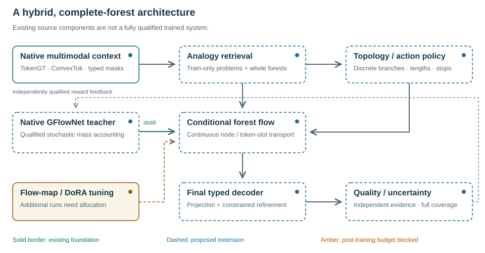

**Figure1.** Solid border denotes an existing foundation, dashed border a proposed extension, and amber an unallocated post-training stage. The diagram is a design specification. Existing component tests are not full native-model release evidence.

A conditional flow transports all free forest coordinates using a declared base-noise path, while clamping known context. Solver time s is distinct from reasoning depth d. In a straight-path reference, Z_s=(1−s)ε+sZ_1 and the target velocity is Z_1−ε; only legitimate available coordinates contribute to the loss. Native width-scaled versus finite axes, readouts, aliases, checkpoint/RNG state and the actual full-head parameter count must be qualified before the applicable μP sweep. No current all-head count is inferred from the diagram.

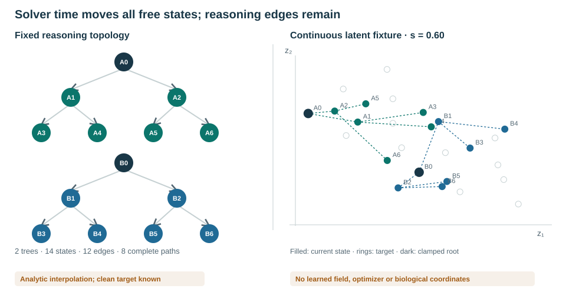

**Figure2.** Two fixed trees have14 states,12 edges and eight complete root-to-leaf paths. Two known roots are clamped. The right-hand points are exact analytic interpolation in a schematic two-dimensional space, not a learned field, molecular coordinates or measured generation quality. Moving s changes all free coordinates without shortening the reasoning graph.

### Probability, feedback and analogy

The target forest measure is π*(F|c)∝R(F,c). A hybrid counting/continuous reference measure and a construction/backward policy must specify whether terminal objects are ordered histories or forest equivalence classes. Their multiplicities differ. An integrable design R=q0 exp(−E), E≥0, separates a normalized base from a domain-conditioned energy. A scalar maximum-reward objective is not identical to this sampling target.

The initial integration will distill a separately qualified stochastic GFlowNet distribution into a conditional flow. Its teacher must be evaluated, not presumed exact. Deterministic ODE updates do not carry Gaussian transition log probabilities. SDE-based flow RL and negative-aware fine-tuning are separate, explicitly named alternatives. Beam-pruned FoT is not on-policy evidence for an unchanged GFN kernel.

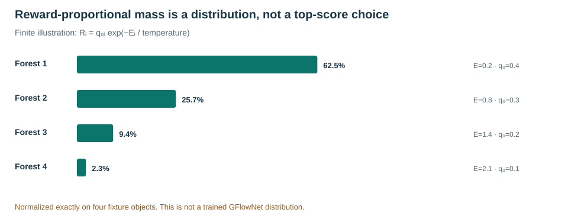

**Figure3.** Four fixture forests use base masses(0.4,0.3,0.2,0.1) and energies(0.2,0.8,1.4,2.1); probabilities are normalized from q0 exp(−E). These values are computed examples, not learned frequencies or reward calibration.

Analogy retrieval uses only available query conditions and train-only group-disjoint problem/forest exemplars. A learned approximate shortlist is followed by full directed relational checks, intermediate subgoal mapping, branch coverage and abstention. Source actions may map to target subtrajectories. Approximate retrieval recall is compared with an exact reference. Frozen encoder/codebook identity is necessary because latent gauge changes invalidate stored geometry.

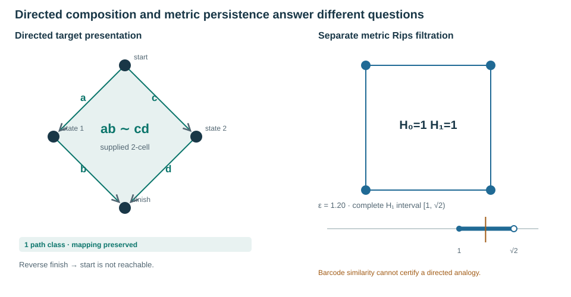

**Figure4.** A supplied two-cell identifies the paths ab and cd; deleting it makes the proposed defining-relation map fail despite unchanged endpoints. Reverse reachability is not inferred. The independent metric example is F₂ Rips homology of a unit square: H₁ is born at1 and dies at√2. Equal barcodes do not prove semantic, geometric or causal equivalence. This finite interpretation is informed by Grandis's directed path and positive-chain constructions; it is not a reconstruction of a continuous biological fundamental category.

### Final token refinement

The existing pooled payload representation is lossy. A new aligned token-slot decoder must be learned before nearest-codebook projection can be useful. Proposed40 reserved control symbols represent structure, actions, evidence roles, relations and dispositions; they are not a recovered Jev vocabulary and have no allocated IDs yet. TypeSafe's public Jev interface motivates typed outputs, not a claim that finite token choices prevent factual errors.

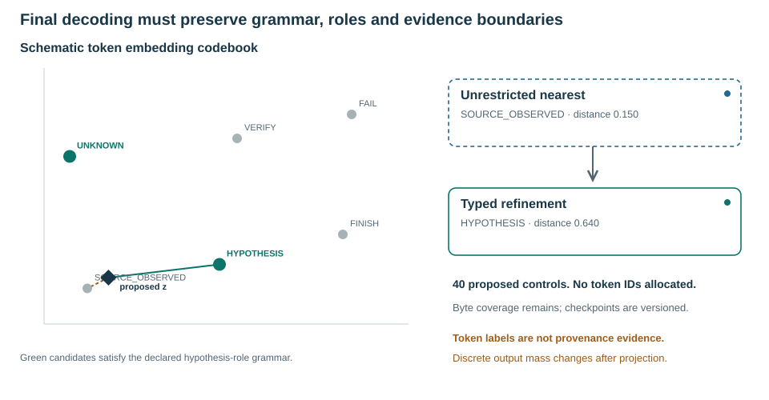

**Figure5.** An unrestricted nearest vector may represent an inadmissible evidence label. A declared grammar restricts refinement to allowed types. The plotted codebook is schematic. A generated SOURCE_OBSERVED symbol is not source evidence. Projection is many-to-one, so discrete output probabilities integrate latent mass over decoding regions and need not preserve latent reward proportionality.

### Few-step conversion and contextual quality adaptation

We select DMF-informed flow-map conversion for native qualification, beginning with frozen-teacher interval-pair regression rather than presuming JVP support in first-order tropical kernels. Learned M(x,s,t) should retain identity and approximate composition. MeanFlow and Align Your Flow are method references; newer MFD is a screened alternative. Image-domain benchmarks do not establish performance for Mora-3 forests.

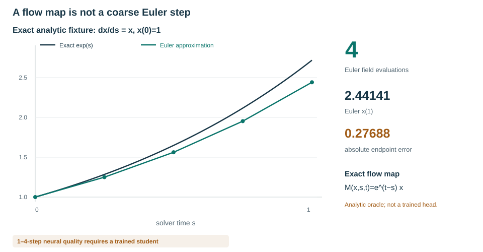

**Figure6.** Exact x(s)=exp(s) and Euler approximations illustrate discretization error. The analytic one-step map is an oracle, not a trained student. Neural1/2/4-step quality, diversity and end-to-end latency require real validation, counting topology, guidance, retrieval and decoding work as well as solver evaluations.

Quality adaptation begins with matched-context signed GraphCG exploration and an unedited control. A direction is not globally bad. Preference records distinguish favored/disfavored, neutral, unknown, conflicting and hard-infeasible cases. Independent outcome evidence and applicable uncertainty determine labels; missing assays are not negative examples. Protein confidence/refolding agreement alone is not experimental stability or function. Mixed-cell communication requires context-specific evidence, not co-expression relabeled causality.

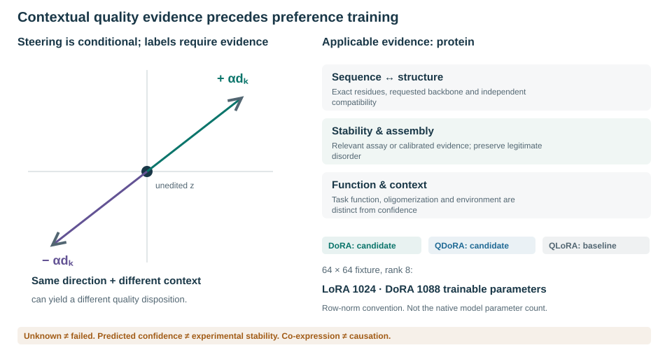

**Figure7.** The evaluation contract is modality-dependent. BF16 DoRA is the quality-first engineering candidate, QDoRA the quantized candidate and QLoRA the reference baseline; there is no established native-model winner. The displayed64×64,rank8 parameter counts are exact algebraic illustrations, not the Mora-3 parameter count. Tied aliases, finite axes, sensitive reductions, norm conventions and tropical behavior require native tests. No packages or adapters were installed.

### Experiment accounting and current evidence

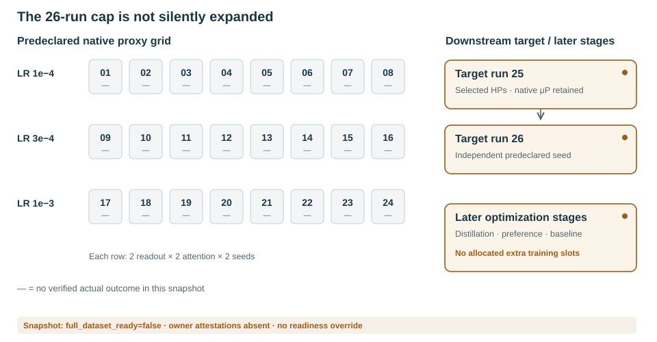

**Figure8.** The authorized base campaign remains24 proxies and two targets. Dashes indicate no verified actual outcomes in the inspected campaign evidence. Later flow-map distillation and preference/baseline training are budget-blocked. They are not relabeled continued runs to evade the cap.

FRF-00 implements the specification and reference visualizations, not the neural extension. At the inspected source snapshot, full_dataset_ready=false, construction/model attestations are absent and the native owner refuses training admission. Current source-exposure/group audits are preserved. No training result, therapeutic efficacy, causal validity or model-quality improvement is asserted.

Full equations, native integration acceptance criteria, failure modes, modality-specific quality requirements, the40-control registry and the ordered task graph are in `../planning/flow_forest_extension_20261111.md`. Exact research/code review boundaries are in `../docs/research/flow_forest_sources_20261111.json`. The interactive companion is `../docs/project/flow-forest.html`; these static vector figures are intended for manuscript inclusion. The paper/PDF itself is not claimed to contain interactive controls.

#### Primary references

Flow Matching, arXiv:2210.02747v2; Continuous GFlowNets,2301.12594v2; MeanFlow,2505.13447; Decoupled MeanFlow,2510.24474; Align Your Flow,official NVIDIA research page; Flow-GRPO,2505.05470v3; DiffusionNFT,2509.16117; DoRA,2402.09353v6; QLoRA,2305.14314; PEFT0.21.0 commit9dc6fa2d2093853dec3889b790d4f251efe7fcac; Grandis,Directed Algebraic Topology(2009); Topological Autoencoders,ICML2020; ProteinBench,2409.06744; Limitations of the refolding pipeline for de novo protein design,Protein Science(2026),doi:10.1002/pro.70613. The detailed planning bibliography provides direct primary-source links and distinguishes screened from implementation-reviewed work.

## Vectorized persistence and information-preserving evidence retention

The implementation now provides batched persistence landscapes, Gaussian pixel-integrated persistence images and explicit L2 feature metrics. Complete finite landscapes are invertible in the mathematical setting; fixed-grid samples, rank truncation and finite images are generally not. Original native diagrams, multiplicities, pairing simplices and essential/censored metadata are retained. Directed path categories and causal/evidence labels remain independent, as do signed geometric constraints such as chirality.

For complete finite diagrams, all births, deaths, peaks and active ascending/descending tent crossings define a shared piecewise-linear basis. Two-point Gauss quadrature on each interval yields Euclidean feature vectors whose squared distance equals the full landscape L2 integral in real arithmetic, with all layers retained. Float64 rounding and explicit resource bounds remain. Sampled features instead use square-root trapezoidal weights and are labeled approximate. Gaussian image pixels integrate density over rectangles; pixel-mass L2 and image-density L2 (mass divided by the square root of pixel area) are explicitly different metrics. Neither is silently identified with bottleneck or Wasserstein distance.

Native condition-only topology-memory retrieval now defaults to batched exact finite-landscape L2, scores every eligible disjoint-group training memory and requires matching essential birth multisets. The original directed/bottleneck structural verifier is unchanged; no acceptance threshold was reinterpreted. Censored filtrations refuse rather than being capped or treated as complete. These numerical components do not grant source/model admission or imply trained reasoning gains.

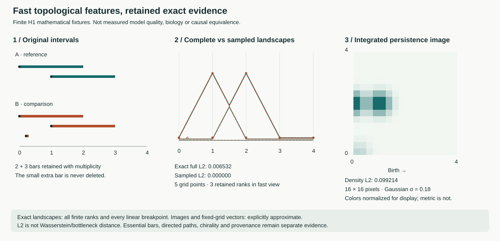

**Figure9.** Two reference intervals are compared to two shifted intervals plus an optional short interval [0.21,0.29]. At zero shift and a five-point grid on [0,4], coarse sampling misses the extra interval while exact full-landscape L2 detects it. The image panel is a Gaussian-integrated feature summary, not a lossless barcode. Display color normalization does not alter the numerical distance. These are mathematical fixtures, not biomedical observations or trained-model evaluations. The [interactive companion](../docs/project/persistence-vectors.html) and paper SVG share one renderer.

Primary sources: Bubenik (2015), JMLR16(3), https://jmlr.org/papers/v16/bubenik15a.html; Bubenik, https://arxiv.org/abs/1810.04963; Adams et al. (2017), JMLR18(8), https://jmlr.org/papers/v18/16-337.html. See [implementation/qualification contract](../planning/persistence_vectorization_20261111.md).

## Multi-candidate flow proposals and FoT-style refinement

The inference controller generates several complete latent forest candidates with
an explicitly supplied conditional velocity field, private generator and known-node
clamps. A separate full-forest verifier assigns scores, applicability and immutable
evidence. Sparse selection activates a bounded diverse candidate set. Rule-based
correction or subtree regeneration creates new candidates while preserving the
originals, unrelated branches and known conditions; changed ancestors invalidate
their replaced descendants. Every revision is assessed again.

After the bounded latent refinement phase, a caller-supplied token decoder and
separate decoded-object verifier produce up to K distinct qualifying outputs, with
K at least2 for this API. Failed decoded objects may receive additional bounded
corrections. Unknown or failed checks never become successes; fewer than K valid
outputs is reported as a shortfall, not padded with duplicates. The controller
retains raw proposals, full edit lineage, candidate/score/decoder revisions,
call counts and all rejected evidence. Selected or edited outputs are not labeled
on-policy samples of the unmodified GFlowNet, and no ODE density is invented.

Bi et al. (ICML2025), sections3.1–3.3 and Algorithms1–2, supplies sparse activation,
score-triggered rule/knowledge-assisted self-correction and consensus/expert
decision-making. Whole-forest flow proposals, explicit subtree replacement and a
multi-output API are Mora-3 adaptations. Multiple independent good solutions are
not collapsed by a compulsory majority vote. Score calibration, native learned
field/decoder integration and held-out quality remain to be qualified.

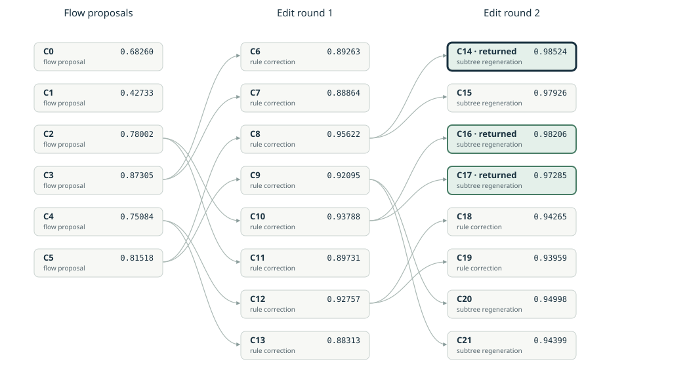

**Figure10.** Synthetic execution of the implemented controller:6 initial candidates,
2 edit rounds,22 total candidates and3 checked token outputs. The analytic score
is mean(exp(-z_first_coordinate_squared)) over non-condition nodes; it is not a
reasoning-accuracy or biological metric. Numerical quantization in this fixture is
not a trained Mora-3 token decoder. The [interactive replay](../docs/project/flow-fot-refinement.html)
shows complete candidate forests and preserves the same SVG export. No optimizer
updates or substantive training runs were performed to produce this figure.

Source: https://proceedings.mlr.press/v267/bi25a.html; detailed implementation
contract: [flow/FoT refinement](../planning/flow_fot_refinement_20261111.md).

## Supplement: native complete-forest neural heads (13 November 2026)

### Implementation status

The conditional flow field, context-only analogy key, token-slot decoder and per-criterion quality head are now implemented as optional trainable modules of the actual source-bound owner. They literally share the existing geometry/TokenGT representation. The factory, unique-parameter/alias ledger, finite-versus-width axis declarations and strict checkpoint paths include the enabled modules. Their disabled defaults preserve the older owner configuration. This is implementation evidence, not trained reasoning quality or full-corpus admission.

The existing forest controller now has a concrete native velocity field and a concrete score-directed subtree-regeneration operator. It can receive a learned decoder rather than a numerical-quantization fixture. A decoder that does not finish within its slot budget returns an explicit repairable refusal; it is not passed to the output assessor as a completed forest. Domain-specific validators and admitted source labels remain necessary. A content hash binds evidence but does not establish that evidence scientifically.

### Shared differentiable forest field

Let X have shape B×N×D, with B independent complete-forest candidates, N declared nodes and a fixed latent coordinate dimension D. Solver time t is separate from reasoning depth. Known conditioning nodes are clamped; the other template values are erased by the sampler before the field receives them. The field reads only source-available biological conditions and explicitly desired values, not hidden targets.

Each node receives projections of its current continuous latent, solver time, depth, completion status, clamped status and directed evidence category, plus the native condition representation. Parent/child edges become explicit directed graph tokens. The actual shared TokenGT processes all nodes and edges jointly, so velocity at one node can depend on the other currently noisy branches. This joint denoising state is not relabeled an observed causal trajectory or a prefix-only stochastic GFlowNet policy.

A native finite-dimensional readout maps each output node to its velocity. Its configured multiplier and width division are applied once. The field preserves the actual selected attention operator; ordinary-attention μP and legacy tropical execution remain separately named. Numerical qualification of the complete extended tropical width family is still required.

For sigma=sigma_min and available free coordinates, the implemented conditional path is

    X_t = [1-(1-sigma)t] epsilon + t Y,
    U_t = Y-(1-sigma) epsilon,
    L_FM = sum_available (v_theta(X_t,t,c,T)-U_t)^2 / count_available.

Unavailable labels do not become zeros. Unavailable coordinates stay noisy; known coordinates stay clamped. Targets are detached. Empty supervision is inactive, not an artificial zero-loss training example. At positive sigma, the terminal conditional path retains sigma epsilon; no exact noise-free endpoint theorem is asserted.

### Complete-forest analogy retrieval

The query readout consumes only native problem context. A separately learned key readout consumes the complete forest representation with each shared ancestor counted once. Both map to a declared finite key dimension and use normalized keys. The supervised objective distinguishes explicit supported positive, supported negative and unknown pairs, excludes shared leakage groups, and accepts train-only examples for optimization.

The immutable index supports exact L2 search and a bounded approximate cell shortlist, preserves the full source forests, and returns explicit shortages. It binds model values, configuration, coordinate system, original splits, groups and source evidence; changed weights require rebuilding the index. A retrieved near neighbor is a candidate for the existing whole-trajectory directed/topological verifier, not proof of semantic analogy or causal transfer. Global group completeness and index recall on real workloads are separate qualifications.

### Finite controls and learned token-slot decoding

The versioned forest axis appends exactly40 controls without renumbering the256 bytes, learned byte-substring vocabulary or pre-existing controls. An ordinary byte string containing the spelling of a control remains ordinary payload, not a structural-token injection. The extension creates a new annotation-vocabulary artifact and identifies the old fit certificate; it does not claim a new ConvexTok optimization or mutate old checkpoint metadata offsets.

The decoder learns a per-node/per-slot projection q into a declared fixed token-codebook space. For permitted codebook rows E_k, logits are

    ell_k = [2 q·E_k - ||E_k||²] / temperature.

The omitted -||q||² term is independent of k, so both nearest-token ranking and softmax probabilities match negative squared L2 distances. This identity does not make arbitrary pooled reasoning vectors invertible; the projection needs actual source-aligned supervision and a qualified codebook/encoder export.

Free-node payloads use byte/substring tokens and one final NODE_END. Structural controls are written by a strict known-skeleton grammar, not emitted arbitrarily inside payloads. Known source payloads are preserved exactly. Missing NODE_END, incomplete forests, inconsistent source/axis identities and output-budget exhaustion are refused, not silently repaired into claimed completions. Generated payloads remain typed as predicted. Token syntax does not certify protein folding, cell behavior, logical validity or source truth.

The masked token objective uses complete contiguous supervised prefixes ending at exactly one stop. Unknown nodes and clamped conditions are not supervised as generated outputs. Exact argmax and cross-entropy scoring stream the complete vocabulary in bounded row blocks without dropping nodes or slots. The training-loss blocks use non-reentrant activation recomputation rather than retaining every logit block for backward; dense/streamed losses and gradients are compared against each other. The frozen codebook is an explicit checkpoint input so its version remains checked. The frozen codebook is checkpointed as a persistent buffer. A different buffer is rejected before any shared model tensor is copied. Model/source/codebook drift invalidates bound decoder objects.

### Learned quality and non-destructive correction

The quality head predicts separate declared criteria for every node and for the complete forest. Its masked binary-cross-entropy objective accepts source-policy-bound support labels in [0,1]; unknown or contradictory evidence is absent from the label mask, not automatically false. All criterion values remain inspectable. Declared ranking weights create only an inference priority, never a hard-constraint acceptance decision. Calibration and independent domain validation remain unmeasured.

The concrete native subtree editor selects an eligible low-scored subtree, draws independent latent noise for that subtree and integrates the actual native field while fixing the other candidate nodes. Preserved generated branches are proposal context, not new observations. Replacement invalidates the entire old descendant subtree, assigns fresh identities and preserves unrelated branches and original conditions. All revisions require fresh whole-forest and decoded-output verification. The exact generator state and actual field-evaluation counts are retained. A bound learned-score adapter supplies the controller with the actual criterion predictions while requiring a separate current-candidate/context/policy constraint verdict. Refused or unknown hard-constraint evidence stays refused or unknown even at a nearly maximal neural score. The full per-criterion values and independent evidence remain recoverable from the returned assessment digest. This operator does not guarantee that a revision improves its predecessor; the controller retains earlier elites and can return multiple distinct qualifying outputs or an explicit shortfall.

Edited, filtered, decoded or beam-selected results are not unmodified on-policy GFlowNet samples. The new deterministic flow has no invented Gaussian transition log likelihood. An admitted hybrid forest teacher, explicit topology/construction measure, reward and native training schedule still need integration before claiming distributional learning.

### Figures and reproducibility

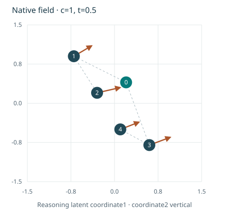

**Native-field figure.** The displayed arrows are outputs of a randomly initialized width16 native field, not an analytic stand-in and not a trained model. Coordinates are reasoning latents rather than physical positions. The root velocity is zero. Changing a hidden target from7 to999999 leaves the retained evaluations unchanged. All time/condition views use one common coordinate scale. The component has12,850 unique parameters,306 of them added beyond its shared geometry representation; this is not the full approximately80M model count.

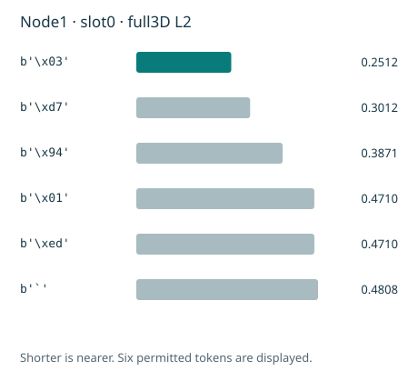

**Native-token figure.** The bars show full three-dimensional L2 distances from one learned-slot projection at random initialization to the six nearest permitted rows of a synthetic frozen codebook. They are not sequence quality or trained probability calibration. The [interactive companion](../docs/project/native-forest-heads.html) uses the same SVG renderer, exposes retained field conditions/times, token slots, criterion outputs and exact-versus-approximate retrieval. It performs no live training, uploads or model-network calls.

The final isolated combined verification passed301 focused tests, with no optimizer-step attempts, including existing owner, SCRI, native trajectory/GFN, persistence and24+2 campaign-transfer regressions. Six installed-Chrome workflow tests passed. These counts are scoped software evidence, not full-repository coverage or empirical μTransfer. Source datasets, complete-context identifier capacity, unknown-topology policy, matched native validation reference, real optimizer/recovery/resources, same-snapshot independent owner attestations and a current admitted campaign remain unresolved. Additional few-step distillation and preference/comparison optimizer runs remain outside the unchanged26-run allocation.

Primary method references: Lipman et al., Flow Matching for Generative Modeling, arXiv:2210.02747; Li et al., Diffusion-LM, arXiv:2205.14217; Yang et al., Tensor Programs V, arXiv:2203.03466; Bi et al., Forest-of-Thought, arXiv:2412.09078. Shared native forest fields, finite-axis decoder/refusal semantics and whole-forest retrieval/scoring described here are Mora-3 adaptations, not demonstrated results from those papers.

## Source consolidation and complete registered-view group audit — 13 November 2026

The combined implementation preserves the native forest, trajectory and SCRI owners while incorporating newer source/cursor/optimizer/RNG work. A guarded source-level audit accounted for82,262 original descriptors and80,656,029 selected task views (80,612,917 train;10,076 validation;33,036 test). It found zero cross-role literal effective-group keys and task identities, with no missing-group rows, while preserving existing official roles and current masks. This is a scoped declared-key separation result, not a proof of unknown biological independence, cross-source identifier equivalence, within-training deduplication or full expanded-corpus admission. The audit did not decode native numeric/condition/target columns or rewrite splits.

The component-level stratifier preserves fixed roles and reports infeasible balance instead of splitting related records. New M-CSA materializer/executable bindings and an isolated metadata loader close observed implementation defects. The focused combined suite passed506 tests and60 subtests, with zero optimizer-step attempts. No24-trial campaign, target run, empirical transfer or trained heldout performance is established by these tests. Full methods, incorporation dispositions, original-source denominators and limitations are in [the consolidation note](../docs/consolidation_20261113.md).

## GRH-research native computation bridge

The pinned independent GRH-research numerical exports now enter the existing native ReasoningTrace/prefix-graph interfaces through exact finite tensor and dependency checks. The whole known-program execution schedule is not conflated with a searched forest; the operation-specific view excludes future tensors and unrelated branches. All references remain test-only computed evidence, conservatively grouped by source revision/checkpoint. Actual masked tropical max-plus context and complete tied winners agree exactly with an independent calculation on the retained export. This is not a proof of GRH, empirical μTransfer or biological validity.

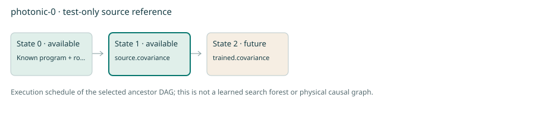

The [interactive companion](../docs/project/grh-research-bridge.html) uses the same SVG renderer and exposes source provenance, all prefix visibility states and separately hidden reference values. [Detailed methods and GRH biological-source boundaries](grh_research_bridge_methods.md) preserve existing computed-label semantics and inactive cross-corpus conflicts. No additional training runs are allocated or started by this source integration.
