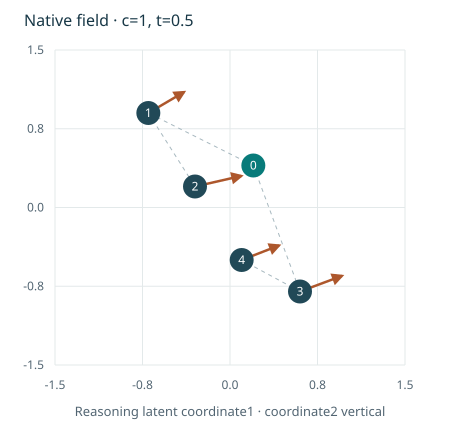
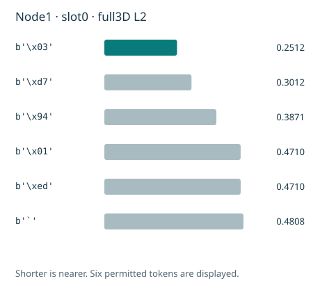

# Native complete-forest neural heads — 13 November 2026

## Implementation status

The conditional flow field, context-only analogy key, token-slot decoder and per-criterion quality head are now implemented as optional trainable modules of the actual source-bound owner. They literally share the existing geometry/TokenGT representation. The factory, unique-parameter/alias ledger, finite-versus-width axis declarations and strict checkpoint paths include the enabled modules. Their disabled defaults preserve the older owner configuration. This is implementation evidence, not trained reasoning quality or full-corpus admission.

The existing forest controller now has a concrete native velocity field and a concrete score-directed subtree-regeneration operator. It can receive a learned decoder rather than a numerical-quantization fixture. A decoder that does not finish within its slot budget returns an explicit repairable refusal; it is not passed to the output assessor as a completed forest. Domain-specific validators and admitted source labels remain necessary. A content hash binds evidence but does not establish that evidence scientifically.

## Shared differentiable forest field

Let X have shape B×N×D, with B independent complete-forest candidates, N declared nodes and a fixed latent coordinate dimension D. Solver time t is separate from reasoning depth. Known conditioning nodes are clamped; the other template values are erased by the sampler before the field receives them. The field reads only source-available biological conditions and explicitly desired values, not hidden targets.

Each node receives projections of its current continuous latent, solver time, depth, completion status, clamped status and directed evidence category, plus the native condition representation. Parent/child edges become explicit directed graph tokens. The actual shared TokenGT processes all nodes and edges jointly, so velocity at one node can depend on the other currently noisy branches. This joint denoising state is not relabeled an observed causal trajectory or a prefix-only stochastic GFlowNet policy.

A native finite-dimensional readout maps each output node to its velocity. Its configured multiplier and width division are applied once. The field preserves the actual selected attention operator; ordinary-attention μP and legacy tropical execution remain separately named. Numerical qualification of the complete extended tropical width family is still required.

For sigma=sigma_min and available free coordinates, the implemented conditional path is

    X_t = [1-(1-sigma)t] epsilon + t Y,
    U_t = Y-(1-sigma) epsilon,
    L_FM = sum_available (v_theta(X_t,t,c,T)-U_t)^2 / count_available.

Unavailable labels do not become zeros. Unavailable coordinates stay noisy; known coordinates stay clamped. Targets are detached. Empty supervision is inactive, not an artificial zero-loss training example. At positive sigma, the terminal conditional path retains sigma epsilon; no exact noise-free endpoint theorem is asserted.

## Complete-forest analogy retrieval

The query readout consumes only native problem context. A separately learned key readout consumes the complete forest representation with each shared ancestor counted once. Both map to a declared finite key dimension and use normalized keys. The supervised objective distinguishes explicit supported positive, supported negative and unknown pairs, excludes shared leakage groups, and accepts train-only examples for optimization.

The immutable index supports exact L2 search and a bounded approximate cell shortlist, preserves the full source forests, and returns explicit shortages. It binds model values, configuration, coordinate system, original splits, groups and source evidence; changed weights require rebuilding the index. A retrieved near neighbor is a candidate for the existing whole-trajectory directed/topological verifier, not proof of semantic analogy or causal transfer. Global group completeness and index recall on real workloads are separate qualifications.

## Finite controls and learned token-slot decoding

The versioned forest axis appends exactly40 controls without renumbering the256 bytes, learned byte-substring vocabulary or pre-existing controls. An ordinary byte string containing the spelling of a control remains ordinary payload, not a structural-token injection. The extension creates a new annotation-vocabulary artifact and identifies the old fit certificate; it does not claim a new ConvexTok optimization or mutate old checkpoint metadata offsets.

The decoder learns a per-node/per-slot projection q into a declared fixed token-codebook space. For permitted codebook rows E_k, logits are

    ell_k = [2 q·E_k - ||E_k||²] / temperature.

The omitted -||q||² term is independent of k, so both nearest-token ranking and softmax probabilities match negative squared L2 distances. This identity does not make arbitrary pooled reasoning vectors invertible; the projection needs actual source-aligned supervision and a qualified codebook/encoder export.

Free-node payloads use byte/substring tokens and one final NODE_END. Structural controls are written by a strict known-skeleton grammar, not emitted arbitrarily inside payloads. Known source payloads are preserved exactly. Missing NODE_END, incomplete forests, inconsistent source/axis identities and output-budget exhaustion are refused, not silently repaired into claimed completions. Generated payloads remain typed as predicted. Token syntax does not certify protein folding, cell behavior, logical validity or source truth.

The masked token objective uses complete contiguous supervised prefixes ending at exactly one stop. Unknown nodes and clamped conditions are not supervised as generated outputs. Exact argmax and cross-entropy scoring stream the complete vocabulary in bounded row blocks without dropping nodes or slots. The training-loss blocks use non-reentrant activation recomputation rather than retaining every logit block for backward; dense/streamed losses and gradients are compared against each other. The frozen codebook is an explicit checkpoint input so its version remains checked. The frozen codebook is checkpointed as a persistent buffer. A different buffer is rejected before any shared model tensor is copied. Model/source/codebook drift invalidates bound decoder objects.

## Learned quality and non-destructive correction

The quality head predicts separate declared criteria for every node and for the complete forest. Its masked binary-cross-entropy objective accepts source-policy-bound support labels in [0,1]; unknown or contradictory evidence is absent from the label mask, not automatically false. All criterion values remain inspectable. Declared ranking weights create only an inference priority, never a hard-constraint acceptance decision. Calibration and independent domain validation remain unmeasured.

The concrete native subtree editor selects an eligible low-scored subtree, draws independent latent noise for that subtree and integrates the actual native field while fixing the other candidate nodes. Preserved generated branches are proposal context, not new observations. Replacement invalidates the entire old descendant subtree, assigns fresh identities and preserves unrelated branches and original conditions. All revisions require fresh whole-forest and decoded-output verification. The exact generator state and actual field-evaluation counts are retained. A bound learned-score adapter supplies the controller with the actual criterion predictions while requiring a separate current-candidate/context/policy constraint verdict. Refused or unknown hard-constraint evidence stays refused or unknown even at a nearly maximal neural score. The full per-criterion values and independent evidence remain recoverable from the returned assessment digest. This operator does not guarantee that a revision improves its predecessor; the controller retains earlier elites and can return multiple distinct qualifying outputs or an explicit shortfall.

Edited, filtered, decoded or beam-selected results are not unmodified on-policy GFlowNet samples. The new deterministic flow has no invented Gaussian transition log likelihood. An admitted hybrid forest teacher, explicit topology/construction measure, reward and native training schedule still need integration before claiming distributional learning.

## Figures and reproducibility

**Native-field figure.** The displayed arrows are outputs of a randomly initialized width16 native field, not an analytic stand-in and not a trained model. Coordinates are reasoning latents rather than physical positions. The root velocity is zero. Changing a hidden target from7 to999999 leaves the retained evaluations unchanged. All time/condition views use one common coordinate scale. The component has12,850 unique parameters,306 of them added beyond its shared geometry representation; this is not the full approximately80M model count.

**Native-token figure.** The bars show full three-dimensional L2 distances from one learned-slot projection at random initialization to the six nearest permitted rows of a synthetic frozen codebook. They are not sequence quality or trained probability calibration. The [interactive companion](../docs/project/native-forest-heads.html) uses the same SVG renderer, exposes retained field conditions/times, token slots, criterion outputs and exact-versus-approximate retrieval. It performs no live training, uploads or model-network calls.

The final isolated combined verification passed301 focused tests, with no optimizer-step attempts, including existing owner, SCRI, native trajectory/GFN, persistence and24+2 campaign-transfer regressions. Six installed-Chrome workflow tests passed. These counts are scoped software evidence, not full-repository coverage or empirical μTransfer. Source datasets, complete-context identifier capacity, unknown-topology policy, matched native validation reference, real optimizer/recovery/resources, same-snapshot independent owner attestations and a current admitted campaign remain unresolved. Additional few-step distillation and preference/comparison optimizer runs remain outside the unchanged26-run allocation.

Primary method references: Lipman et al., Flow Matching for Generative Modeling, arXiv:2210.02747; Li et al., Diffusion-LM, arXiv:2205.14217; Yang et al., Tensor Programs V, arXiv:2203.03466; Bi et al., Forest-of-Thought, arXiv:2412.09078. Shared native forest fields, finite-axis decoder/refusal semantics and whole-forest retrieval/scoring described here are Mora-3 adaptations, not demonstrated results from those papers.
