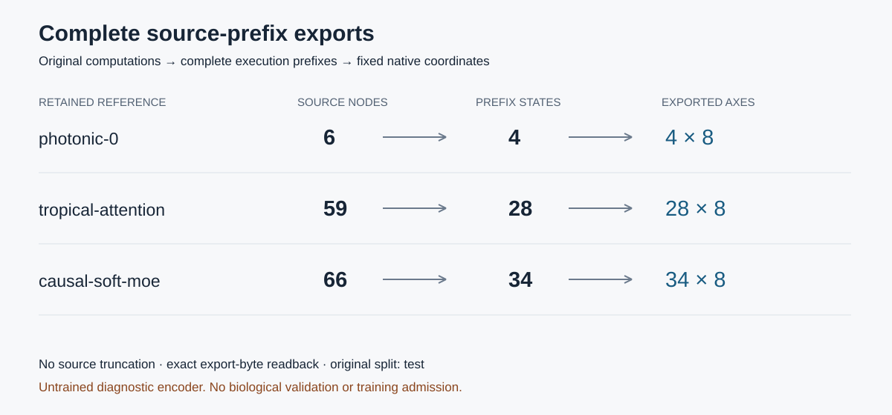

# Source-aligned complete-prefix export methods

The source compiler preserves complete known tree trajectories and computes each
latent from its own complete native ancestor prefix. Immutable source identities,
original splits, lexical payloads and native direction categories remain bound.
The separately frozen encoder and actual extended token-codebook rows are exported
under exact implementation/weight/configuration identities. This is a lossy learned
representation architecture, instantiated with an explicitly untrained diagnostic
encoder for the retained reference checks; it does not establish learned reasoning
quality, a biological intervention, or training admission.

Three given numerical programs produce4,28 and34 complete prefix states, respectively,
with8FP64 coordinates per state and exact source/export readback. A separately
versioned131072-token per-entity bound preserves the largest81761-token native
payload; the default8192 behavior remains unchanged. Aggregate prefix work is
not an attention context-length claim. Future, sibling and hidden target values
remain excluded from earlier prefix inputs. Unknown topology, merged histories,
production source supervision and complete model qualification are not inferred.

Figure: original dataflow vertices, complete execution-prefix states and retained
coordinate axes. This is source-export evidence, not a training or quality result.
The interactive companion exposes all coordinates and original export commitments.
See [the full source-export methods](../docs/source_forest_exports_20261114.md).
